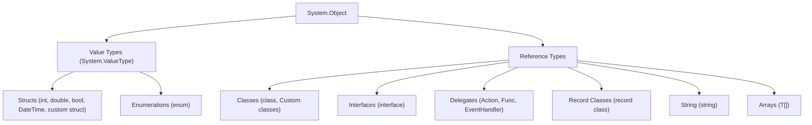
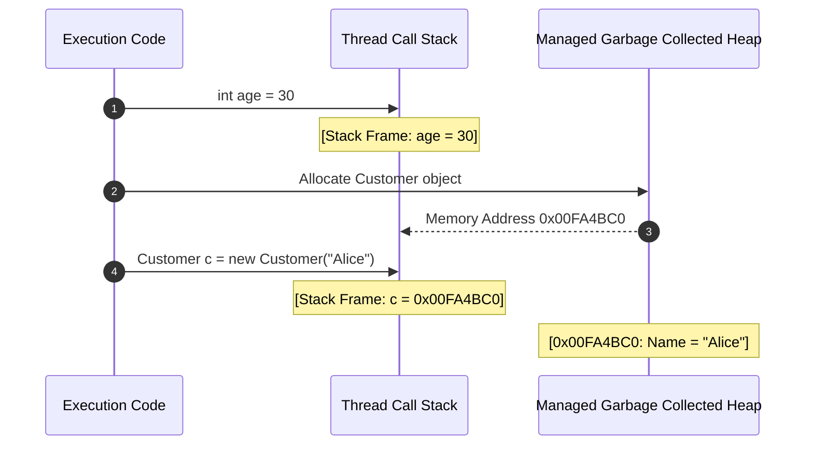

<!-- 01-csharp-syntax-type-system-nullability.md -->
# 1.1 C# Syntax, Type System & Nullability

## Learning Objectives
- Master the Common Type System (CTS) in .NET, distinguishing between value types and reference types on the stack and heap.
- Understand stack allocation vs. heap allocation, boxing/unboxing, and memory management implications.
- Gain complete fluency with Nullable Reference Types (NRT), null-forgiving operators, and defensive programming patterns.
- Implement robust input normalization and type casting using pattern-matching keywords (`is`, `as`, pattern assignment).

---

## 1. The .NET Common Type System (CTS)

C# is a strongly-typed, object-oriented language running atop the Common Language Runtime (CLR). Every type in C# directly or indirectly inherits from `System.Object`.



### Memory Mechanics: Stack vs. Heap

| Dimension | Stack Memory | Heap Memory |
| :--- | :--- | :--- |
| **Allocation Target** | Local variables of value types, method execution frames | Reference type objects, boxed values |
| **Lifecycle** | LIFO; automatically deallocated when exiting variable scope | Managed by the Garbage Collector (GC) generations (Gen 0, 1, 2) |
| **Speed** | Extremely fast pointer arithmetic | Requires allocation scanning and eventual GC compaction |
| **Default Assignment** | Value copying (bitwise copy of data) | Reference copying (copying the memory address) |



---

## 2. Complete Code Example: Value vs. Reference Types & Boxing

Save this as a standard .NET console project using `dotnet new console`:

```csharp
namespace Module01.TypeSystem;

public struct CoordinatePoint
{
    public double X { get; set; }
    public double Y { get; set; }

    public CoordinatePoint(double x, double y)
    {
        X = x;
        Y = y;
    }

    public override string ToString() => $"({X}, {Y})";
}

public class GeoLocation
{
    public string City { get; set; }
    public CoordinatePoint Coordinates { get; set; }

    public GeoLocation(string city, CoordinatePoint coordinates)
    {
        City = city;
        Coordinates = coordinates;
    }

    public override string ToString() => $"{City} at {Coordinates}";
}

public static class MemoryMechanicsDemo
{
    public static void Run()
    {
        Console.WriteLine("=== Value Type Copy Behavior ===");
        CoordinatePoint pointA = new CoordinatePoint(10.5, 20.5);
        CoordinatePoint pointB = pointA; // Full bitwise copy
        pointB.X = 99.9;

        Console.WriteLine($"Point A: {pointA}"); // Output: (10.5, 20.5)
        Console.WriteLine($"Point B: {pointB}"); // Output: (99.9, 20.5)

        Console.WriteLine("\n=== Reference Type Copy Behavior ===");
        GeoLocation locA = new GeoLocation("Stockholm", pointA);
        GeoLocation locB = locA; // Copies memory pointer only
        locB.City = "Gothenburg";

        Console.WriteLine($"Loc A City: {locA.City}"); // Output: Gothenburg
        Console.WriteLine($"Loc B City: {locB.City}"); // Output: Gothenburg

        Console.WriteLine("\n=== Boxing and Unboxing ===");
        int rawNumber = 42;
        // Boxing: Value type copied to heap inside an object box
        object boxed = rawNumber; 
        // Unboxing: Explicit cast extracting value from heap back into stack
        int unboxed = (int)boxed;

        Console.WriteLine($"Raw: {rawNumber}, Boxed: {boxed}, Unboxed: {unboxed}");
    }
}
```

---

## 3. Nullable Reference Types (NRT) & Null-Safety Operators

Starting in modern C#, Nullable Reference Types can be enabled project-wide via `<Nullable>enable</Nullable>` in `.csproj`. This enforces compile-time warnings whenever a reference may evaluate to `null`.

### Null Operators Comparison

1. **Null-Conditional Operator (`?.`)**: Safely short-circuits member access if the target is null.
2. **Null-Coalescing Operator (`??`)**: Returns the left-hand operand if not null; otherwise returns the right-hand operand.
3. **Null-Coalescing Assignment (`??=`)**: Assigns the right-hand value only if the left-hand variable is null.
4. **Null-Forgiving Operator (`!`)**: Explicitly overrides compiler warnings when you guarantee a variable will not be null at runtime.

```csharp
namespace Module01.Nullability;

public sealed class UserProfile
{
    public string Id { get; }
    public string FullName { get; private set; }
    public string? MiddleName { get; set; } // Explicitly nullable
    public string? PreferredContactEmail { get; set; }

    public UserProfile(string id, string fullName, string? middleName = null)
    {
        Id = id ?? throw new ArgumentNullException(nameof(id));
        FullName = fullName ?? throw new ArgumentNullException(nameof(fullName));
        MiddleName = middleName;
    }

    public void UpdateEmail(string? email)
    {
        // Coalescing assignment: only set fallback if null
        email ??= "unspecified@domain.local";
        PreferredContactEmail = email.Trim().ToLowerInvariant();
    }

    public string GetFormalDisplayName()
    {
        // Safe navigation with null coalescing
        string middleInitial = MiddleName?.Length > 0 
            ? $" {MiddleName[0]}." 
            : string.Empty;

        return $"{FullName}{middleInitial}";
    }
}
```

---

## 4. Key Takeaways

1. **Value types** live where declared (on the stack for local variables, or embedded inside heap structures for class fields) and are copied by value.
2. **Reference types** live on the managed heap, tracked and scavenged by the Garbage Collector.
3. **Nullable Reference Types** convert common runtime `NullReferenceException` bugs into actionable compile-time warnings without adding runtime overhead.
