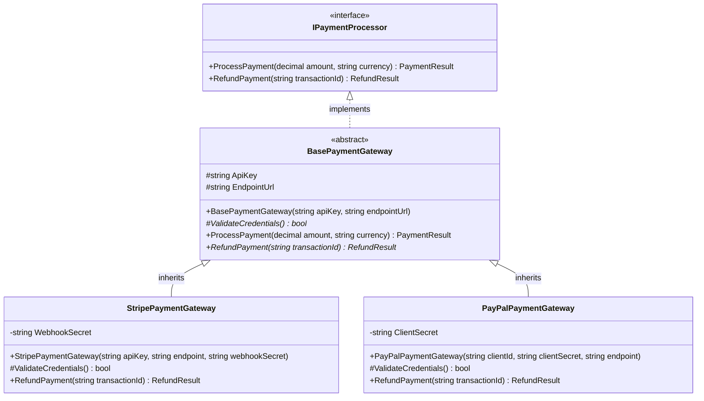

<!-- 02-csharp-oop-principles.md -->
# 1.2 Object-Oriented Programming (OOP) in C#

## Learning Objectives
- Architect domain models applying the four core OOP pillars: Encapsulation, Abstraction, Inheritance, and Polymorphism.
- Leverage access modifiers (`public`, `internal`, `protected`, `private`, `file`) to establish strict visibility boundaries.
- Understand the distinction and synergy between abstract base classes and interfaces.
- Implement polymorphic behavior cleanly using virtual, abstract, and override members without violating the Liskov Substitution Principle (LSP).

---

## 1. The Four Pillars of OOP in C#



---

## 2. Complete Code Implementation

Here is a complete, production-grade payment processing subsystem demonstrating all four OOP pillars:

```csharp
namespace Module01.OopDomain;

// 1. DTOs and Enums
public enum PaymentStatus
{
    Success,
    Failed,
    Declined,
    RequiresVerification
}

public sealed record PaymentResult(
    bool IsSuccess, 
    string TransactionId, 
    PaymentStatus Status, 
    string Message, 
    DateTime ProcessedAtUtc);

public sealed record RefundResult(
    bool IsSuccess, 
    string RefundId, 
    string OriginalTransactionId, 
    string Reason);

// 2. Abstraction via Contract Interface
public interface IPaymentProcessor
{
    PaymentResult ProcessPayment(decimal amount, string currency);
    RefundResult RefundPayment(string transactionId, string reason);
}

// 3. Encapsulation & Polymorphic Foundation via Abstract Class
public abstract class BasePaymentGateway : IPaymentProcessor
{
    // Encapsulated state accessible only to derivative classes
    protected string ApiKey { get; }
    protected string EndpointUrl { get; }

    protected BasePaymentGateway(string apiKey, string endpointUrl)
    {
        if (string.IsNullOrWhiteSpace(apiKey))
        {
            throw new ArgumentException("API key cannot be null or whitespace.", nameof(apiKey));
        }

        if (string.IsNullOrWhiteSpace(endpointUrl) || !Uri.TryCreate(endpointUrl, UriKind.Absolute, out _))
        {
            throw new ArgumentException("Valid absolute URL required.", nameof(endpointUrl));
        }

        ApiKey = apiKey;
        EndpointUrl = endpointUrl;
    }

    // Abstract methods: Must be implemented by derived classes
    protected abstract bool ValidateCredentials();
    public abstract RefundResult RefundPayment(string transactionId, string reason);

    // Template method pattern utilizing virtual/concrete implementations
    public virtual PaymentResult ProcessPayment(decimal amount, string currency)
    {
        if (amount <= 0)
        {
            return new PaymentResult(
                IsSuccess: false,
                TransactionId: string.Empty,
                Status: PaymentStatus.Declined,
                Message: "Amount must be strictly greater than zero.",
                ProcessedAtUtc: DateTime.UtcNow);
        }

        if (!ValidateCredentials())
        {
            return new PaymentResult(
                IsSuccess: false,
                TransactionId: string.Empty,
                Status: PaymentStatus.Failed,
                Message: "Gateway authentication failed.",
                ProcessedAtUtc: DateTime.UtcNow);
        }

        // Concrete execution delegated to subclasses via protected hook or direct execution
        return ExecuteCharge(amount, currency);
    }

    protected abstract PaymentResult ExecuteCharge(decimal amount, string currency);
}

// 4. Inheritance & Concrete Polymorphism: Stripe
public sealed class StripePaymentGateway : BasePaymentGateway
{
    private readonly string _webhookSecret;

    public StripePaymentGateway(string apiKey, string endpointUrl, string webhookSecret)
        : base(apiKey, endpointUrl)
    {
        _webhookSecret = webhookSecret ?? throw new ArgumentNullException(nameof(webhookSecret));
    }

    protected override bool ValidateCredentials()
    {
        // Realistic simulation of token format validation
        return ApiKey.StartsWith("sk_live_") || ApiKey.StartsWith("sk_test_");
    }

    protected override PaymentResult ExecuteCharge(decimal amount, string currency)
    {
        string txnId = $"ch_stripe_{Guid.NewGuid():N}";
        return new PaymentResult(
            IsSuccess: true,
            TransactionId: txnId,
            Status: PaymentStatus.Success,
            Message: $"Stripe charged {amount:C} {currency.ToUpperInvariant()}",
            ProcessedAtUtc: DateTime.UtcNow);
    }

    public override RefundResult RefundPayment(string transactionId, string reason)
    {
        string refundId = $"re_stripe_{Guid.NewGuid():N}";
        return new RefundResult(
            IsSuccess: true,
            RefundId: refundId,
            OriginalTransactionId: transactionId,
            Reason: reason);
    }
}

// 5. Inheritance & Concrete Polymorphism: PayPal
public sealed class PayPalPaymentGateway : BasePaymentGateway
{
    private readonly string _merchantId;

    public PayPalPaymentGateway(string clientId, string merchantId, string endpointUrl)
        : base(clientId, endpointUrl)
    {
        _merchantId = merchantId ?? throw new ArgumentNullException(nameof(merchantId));
    }

    protected override bool ValidateCredentials()
    {
        return ApiKey.Length >= 10 && !string.IsNullOrWhiteSpace(_merchantId);
    }

    protected override PaymentResult ExecuteCharge(decimal amount, string currency)
    {
        string txnId = $"PAYID-{Guid.NewGuid():N}";
        return new PaymentResult(
            IsSuccess: true,
            TransactionId: txnId,
            Status: PaymentStatus.Success,
            Message: $"PayPal captured {amount:F2} {currency.ToUpperInvariant()} for Merchant {_merchantId}",
            ProcessedAtUtc: DateTime.UtcNow);
    }

    public override RefundResult RefundPayment(string transactionId, string reason)
    {
        string refundId = $"REFUND-{Guid.NewGuid():N}";
        return new RefundResult(
            IsSuccess: true,
            RefundId: refundId,
            OriginalTransactionId: transactionId,
            Reason: reason);
    }
}
```

---

## 3. Polymorphism in Action

```csharp
namespace Module01.OopDomain;

public static class PaymentCheckoutRunner
{
    public static void Run()
    {
        // Polymorphic list of processors adhering to IPaymentProcessor
        var processors = new List<IPaymentProcessor>
        {
            new StripePaymentGateway("sk_test_51MzAbcDef123456789", "https://api.stripe.com/v1", "whsec_test"),
            new PayPalPaymentGateway("PAYPAL_CLIENT_ID_XYZ", "MERCHANT_987", "https://api-m.paypal.com")
        };

        decimal orderTotal = 149.99m;
        string currency = "USD";

        foreach (var processor in processors)
        {
            Console.WriteLine($"Initiating checkout with: {processor.GetType().Name}");
            var result = processor.ProcessPayment(orderTotal, currency);

            if (result.IsSuccess)
            {
                Console.WriteLine($"  Status: {result.Status} | Transaction: {result.TransactionId}");
                Console.WriteLine($"  Message: {result.Message}");

                // Immediate refund simulation
                var refund = processor.RefundPayment(result.TransactionId, "Customer cancellation");
                Console.WriteLine($"  Refund: {refund.RefundId} for reason: {refund.Reason}\n");
            }
        }
    }
}
```

---

## 4. Key Takeaways
1. **Encapsulation** protects object integrity by keeping mutable internal state private or protected.
2. **Abstraction** exposes intent via public contracts (`IPaymentProcessor`) while hiding third-party API implementation intricacies.
3. **Inheritance** allows shared code reuse (credential validation, precondition checks in `BasePaymentGateway`).
4. **Polymorphism** allows consumer code to interact with any payment provider interchangeably without runtime coupling.
