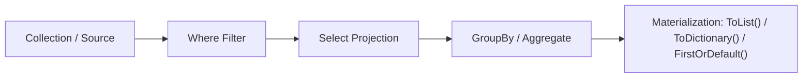
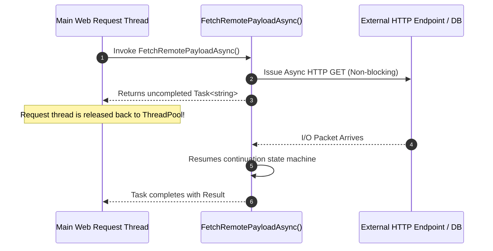

<!-- 03-csharp-modern-linq-async.md -->
# 1.3 Modern C#, LINQ & Async/Await Programming

## Learning Objectives
- Exploit modern C# constructs: Positional Records, value-equality semantics, non-destructive mutation (`with`), and `init`-only properties.
- Construct advanced pattern-matching expressions (property, relational, tuple, and type patterns).
- Leverage Language Integrated Query (LINQ) with deep comprehension of deferred execution and memory evaluation.
- Master asynchronous programming with `Task`, `ValueTask`, `CancellationToken`, concurrent orchestrations (`Task.WhenAll`), and asynchronous streams (`IAsyncEnumerable<T>`).
- Handle enterprise exceptions using custom exception classes and exception filters (`when`).

---

## 1. Records and Immutability

Records provide structural (value-based) equality out of the box, making them ideal for Data Transfer Objects (DTOs), Domain Events, and Value Objects.

```csharp
namespace Module01.ModernCSharp;

// Positional record declaration: generates init-only properties, constructor, Deconstruct, and value equality
public sealed record CustomerAccount(Guid Id, string Username, string Email, decimal CreditBalance);

public static class RecordDemonstration
{
    public static void Run()
    {
        var account1 = new CustomerAccount(Guid.Parse("aaaaaaaa-bbbb-cccc-dddd-eeeeeeeeeeee"), "alice_dev", "alice@domain.com", 250.00m);
        var account2 = new CustomerAccount(Guid.Parse("aaaaaaaa-bbbb-cccc-dddd-eeeeeeeeeeee"), "alice_dev", "alice@domain.com", 250.00m);

        // Value equality (true, unlike standard class references which check pointer identity)
        bool areEqual = account1 == account2; 
        Console.WriteLine($"Structural equality comparison: {areEqual}"); // True

        // Non-destructive mutation using the 'with' expression
        var upgradedAccount = account1 with { CreditBalance = 1000.00m };
        Console.WriteLine($"Original Balance: {account1.CreditBalance:C}"); // $250.00
        Console.WriteLine($"Upgraded Balance: {upgradedAccount.CreditBalance:C}"); // $1,000.00
    }
}
```

---

## 2. Advanced Pattern Matching

Modern C# switch expressions allow concise, declarative rule evaluation:

```csharp
namespace Module01.ModernCSharp;

public enum CustomerTier { Standard, Gold, Platinum }

public sealed record CustomerOrder(
    string OrderId, 
    CustomerTier Tier, 
    decimal Subtotal, 
    int TotalItems, 
    bool HasCoupon);

public static class OrderPricingCalculator
{
    public static decimal CalculateDiscountPercentage(CustomerOrder order) => order switch
    {
        // Relational and logical patterns
        { Subtotal: >= 500m, Tier: CustomerTier.Platinum } => 0.25m,
        { Subtotal: >= 250m, Tier: CustomerTier.Gold or CustomerTier.Platinum } => 0.18m,
        { TotalItems: > 10, HasCoupon: true } => 0.15m,
        { Tier: CustomerTier.Gold } => 0.10m,
        { Subtotal: > 100m } => 0.05m,
        _ => 0.00m // Default fallback
    };
}
```

---

## 3. High-Performance LINQ



> [!IMPORTANT]
> **Deferred Execution**: LINQ operators like `Where`, `Select`, `Take`, and `Skip` are evaluated lazily. Computation occurs only when the sequence is iterated (`foreach`, `ToList()`, `ToArray()`, `Count()`).

```csharp
namespace Module01.ModernCSharp;

public sealed record Transaction(Guid Id, string Category, decimal Amount, DateTime Timestamp);

public static class LinqAnalytics
{
    public static void AnalyzeTransactions(IEnumerable<Transaction> transactions)
    {
        // 1. Filtering & Projection (Deferred Execution)
        var largeTransactions = transactions
            .Where(t => t.Amount > 100.00m && t.Timestamp >= DateTime.UtcNow.AddDays(-30))
            .OrderByDescending(t => t.Amount);

        // 2. Grouping and Aggregation (Materialized)
        var categoryTotals = transactions
            .GroupBy(t => t.Category)
            .Select(group => new
            {
                Category = group.Key,
                TotalVolume = group.Sum(t => t.Amount),
                Count = group.Count(),
                AverageAmount = group.Average(t => t.Amount)
            })
            .OrderByDescending(summary => summary.TotalVolume)
            .ToList(); // Materialized to memory list

        foreach (var stat in categoryTotals)
        {
            Console.WriteLine($"Category '{stat.Category}': Total = {stat.TotalVolume:C}, Avg = {stat.AverageAmount:C} ({stat.Count} txns)");
        }
    }
}
```

---

## 4. Async/Await, Cancellation & Concurrency

Asynchronous methods yield thread control to the CLR thread pool while waiting for I/O operations (network, disk, database), preventing thread starvation.



### Complete Asynchronous Downloader with `CancellationToken` and Async Streams

```csharp
namespace Module01.ModernCSharp;

using System.Runtime.CompilerServices;

public sealed class StockQuote
{
    public string Symbol { get; set; } = string.Empty;
    public decimal Price { get; set; }
    public DateTime FetchedAt { get; set; }
}

public sealed class StockMarketService
{
    private static readonly Random Rnd = new();

    public async Task<StockQuote> FetchQuoteAsync(string symbol, CancellationToken cancellationToken = default)
    {
        // Simulate network latency non-blockingly
        await Task.Delay(250, cancellationToken);

        if (symbol.Equals("INVALID", StringComparison.OrdinalIgnoreCase))
        {
            throw new ArgumentException($"Unknown ticker symbol '{symbol}'", nameof(symbol));
        }

        return new StockQuote
        {
            Symbol = symbol.ToUpperInvariant(),
            Price = Math.Round((decimal)(Rnd.NextDouble() * 500 + 50), 2),
            FetchedAt = DateTime.UtcNow
        };
    }

    public async Task<IReadOnlyList<StockQuote>> FetchMultipleQuotesConcurrentlyAsync(
        IEnumerable<string> symbols, 
        CancellationToken cancellationToken = default)
    {
        // Fan-out: Execute concurrent asynchronous tasks
        var tasks = symbols.Select(sym => FetchQuoteAsync(sym, cancellationToken)).ToList();

        // Await completion of all tasks in parallel
        StockQuote[] results = await Task.WhenAll(tasks);
        return results;
    }

    // Async Stream: Emits items one by one asynchronously without holding whole dataset in memory
    public async IAsyncEnumerable<StockQuote> StreamLiveTicksAsync(
        string symbol, 
        int totalTicks, 
        [EnumeratorCancellation] CancellationToken cancellationToken = default)
    {
        for (int i = 0; i < totalTicks; i++)
        {
            cancellationToken.ThrowIfCancellationRequested();
            await Task.Delay(500, cancellationToken);

            yield return new StockQuote
            {
                Symbol = symbol.ToUpperInvariant(),
                Price = Math.Round((decimal)(Rnd.NextDouble() * 200 + 100), 2),
                FetchedAt = DateTime.UtcNow
            };
        }
    }
}
```

---

## 5. Enterprise Exception Handling with Filters

```csharp
namespace Module01.ModernCSharp;

public sealed class PaymentServiceException : Exception
{
    public int ErrorCode { get; }
    public string GatewayReference { get; }

    public PaymentServiceException(string message, int errorCode, string gatewayReference, Exception? inner = null)
        : base(message, inner)
    {
        ErrorCode = errorCode;
        GatewayReference = gatewayReference;
    }
}

public static class ExceptionHandlingDemo
{
    public static void ProcessWithFilter(Action action)
    {
        try
        {
            action();
        }
        catch (PaymentServiceException ex) when (ex.ErrorCode == 404)
        {
            Console.WriteLine($"[Handled 404] Target resource not found: {ex.Message}");
        }
        catch (PaymentServiceException ex) when (ex.ErrorCode >= 500)
        {
            Console.WriteLine($"[CRITICAL GATEWAY ERROR] Code: {ex.ErrorCode}, Ref: {ex.GatewayReference}. Error: {ex.Message}");
        }
        catch (Exception ex)
        {
            Console.WriteLine($"[Unhandled Generic Exception]: {ex.Message}");
            throw; // Re-throw preserving stack trace
        }
        finally
        {
            Console.WriteLine("[Audit] Execution exited try-catch-finally block.");
        }
    }
}
```
