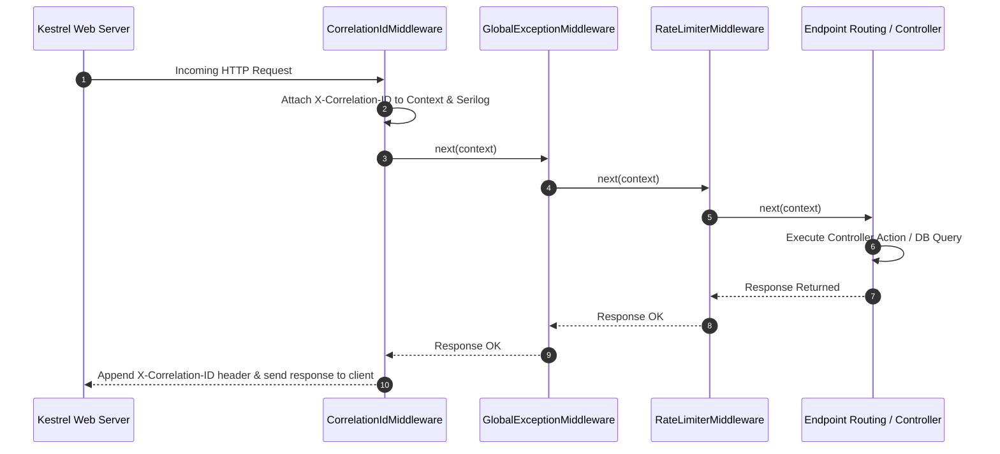

<!-- 08-aspnet-middleware-error-handling-serilog.md -->
# 2.4 Middleware Pipeline, Global Error Handling & Serilog

## Learning Objectives
- Master the ASP.NET Core middleware chain execution flow (`RequestDelegate`, `InvokeAsync`, and pipeline ordering).
- Build production custom middleware for Correlation IDs and Request-Response latency tracking.
- Implement standardized global exception handling adhering to RFC 7807 Problem Details.
- Configure structured JSON logging with **Serilog**, sinks, and contextual enrichment.

---

## 1. The ASP.NET Core Middleware Pipeline Architecture

Middleware components form a bidirectional chain wrapping every HTTP request:



> [!CRITICAL]
> **Pipeline Ordering Matters**: Exception-handling middleware must be placed **at the very beginning** of the pipeline so it can catch unhandled exceptions thrown by any downstream middleware or endpoint handlers.

---

## 2. Correlation ID & Latency Middleware

```csharp
namespace Module02.WebApi.Middleware;

using System.Diagnostics;
using Serilog.Context;

public sealed class CorrelationAndTimingMiddleware
{
    private const string CorrelationHeader = "X-Correlation-ID";
    private readonly RequestDelegate _next;
    private readonly ILogger<CorrelationAndTimingMiddleware> _logger;

    public CorrelationAndTimingMiddleware(RequestDelegate next, ILogger<CorrelationAndTimingMiddleware> logger)
    {
        _next = next;
        _logger = logger;
    }

    public async Task InvokeAsync(HttpContext context)
    {
        // 1. Resolve or generate Correlation ID
        if (!context.Request.Headers.TryGetValue(CorrelationHeader, out var correlationId) || 
            string.IsNullOrWhiteSpace(correlationId))
        {
            correlationId = Guid.NewGuid().ToString("N");
        }

        context.Items[CorrelationHeader] = correlationId.ToString();
        context.Response.Headers[CorrelationHeader] = correlationId.ToString();

        // 2. Measure execution time and enrich Serilog LogContext
        var stopwatch = Stopwatch.StartNew();
        using (LogContext.PushProperty("CorrelationId", correlationId.ToString()))
        {
            try
            {
                await _next(context);
            }
            finally
            {
                stopwatch.Stop();
                _logger.LogInformation(
                    "HTTP {Method} {Path} responded {StatusCode} in {ElapsedMs:0.000} ms",
                    context.Request.Method,
                    context.Request.Path,
                    context.Response.StatusCode,
                    stopwatch.Elapsed.TotalMilliseconds);
            }
        }
    }
}
```

---

## 3. RFC 7807 Global Exception Handling Middleware

```csharp
namespace Module02.WebApi.Middleware;

using System.Net;
using System.Text.Json;
using Microsoft.AspNetCore.Mvc;

public sealed class GlobalExceptionHandlerMiddleware
{
    private readonly RequestDelegate _next;
    private readonly ILogger<GlobalExceptionHandlerMiddleware> _logger;

    public GlobalExceptionHandlerMiddleware(RequestDelegate next, ILogger<GlobalExceptionHandlerMiddleware> logger)
    {
        _next = next;
        _logger = logger;
    }

    public async Task InvokeAsync(HttpContext context)
    {
        try
        {
            await _next(context);
        }
        catch (Exception ex)
        {
            _logger.LogError(ex, "An unhandled exception occurred processing request {Path}", context.Request.Path);
            await HandleExceptionAsync(context, ex);
        }
    }

    private static Task HandleExceptionAsync(HttpContext context, Exception exception)
    {
        context.Response.ContentType = "application/problem+json";

        var (statusCode, title) = exception switch
        {
            KeyNotFoundException => (HttpStatusCode.NotFound, "Resource Not Found"),
            ArgumentException => (HttpStatusCode.BadRequest, "Invalid Argument Provided"),
            InvalidOperationException => (HttpStatusCode.Conflict, "Invalid Domain Operation"),
            UnauthorizedAccessException => (HttpStatusCode.Unauthorized, "Unauthorized Access"),
            _ => (HttpStatusCode.InternalServerError, "An unexpected internal server error occurred.")
        };

        context.Response.StatusCode = (int)statusCode;

        var problemDetails = new ProblemDetails
        {
            Status = (int)statusCode,
            Title = title,
            Detail = exception.Message,
            Instance = context.Request.Path,
            Type = $"https://httpstatuses.com/{(int)statusCode}"
        };

        // Attach correlation id if present
        if (context.Items.TryGetValue("X-Correlation-ID", out var correlationId))
        {
            problemDetails.Extensions["correlationId"] = correlationId;
        }

        var json = JsonSerializer.Serialize(problemDetails, new JsonSerializerOptions
        {
            PropertyNamingPolicy = JsonNamingPolicy.CamelCase
        });

        return context.Response.WriteAsync(json);
    }
}
```

---

## 4. Serilog Configuration in Program.cs

Install required NuGet packages:
```bash
dotnet add package Serilog.AspNetCore
dotnet add package Serilog.Sinks.Console
dotnet add package Serilog.Sinks.File
```

```csharp
// Program.cs
using Serilog;
using Module02.WebApi.Middleware;

// 1. Initialize bootstrap logger
Log.Logger = new LoggerConfiguration()
    .WriteTo.Console()
    .CreateBootstrapLogger();

try
{
    Log.Information("Starting Web Host application...");

    var builder = WebApplication.CreateBuilder(args);

    // 2. Clear default providers and bind Serilog
    builder.Host.UseSerilog((context, services, configuration) => configuration
        .ReadFrom.Configuration(context.Configuration)
        .ReadFrom.Services(services)
        .Enrich.FromLogContext()
        .Enrich.WithMachineName()
        .Enrich.WithThreadId()
        .WriteTo.Console(outputTemplate: 
            "[{Timestamp:HH:mm:ss} {Level:u3}] [{CorrelationId}] {Message:lj}{NewLine}{Exception}")
        .WriteTo.File("logs/api-.log", rollingInterval: RollingInterval.Day));

    builder.Services.AddEndpointsApiExplorer();

    var app = builder.Build();

    // 3. Register Middleware in strict sequential order
    app.UseMiddleware<GlobalExceptionHandlerMiddleware>();
    app.UseMiddleware<CorrelationAndTimingMiddleware>();

    // 4. Sample Endpoint that throws an unhandled error for verification
    app.MapGet("/api/test-error", () =>
    {
        throw new InvalidOperationException("Demonstrating global RFC 7807 problem details capture.");
    });

    app.MapGet("/api/health", () => Results.Ok(new { Status = "Healthy", Utc = DateTime.UtcNow }));

    app.Run();
}
catch (Exception ex)
{
    Log.Fatal(ex, "Host terminated unexpectedly");
}
finally
{
    Log.CloseAndFlush();
}
```

---

## 5. Key Takeaways
1. Custom middleware wraps HTTP execution in a functional **chain-of-responsibility**.
2. **RFC 7807 Problem Details** provides standard JSON error formats across all REST consumers.
3. **Structured logging** with Serilog captures queryable properties (e.g. `CorrelationId`, `StatusCode`, `ElapsedMs`) instead of opaque strings.
