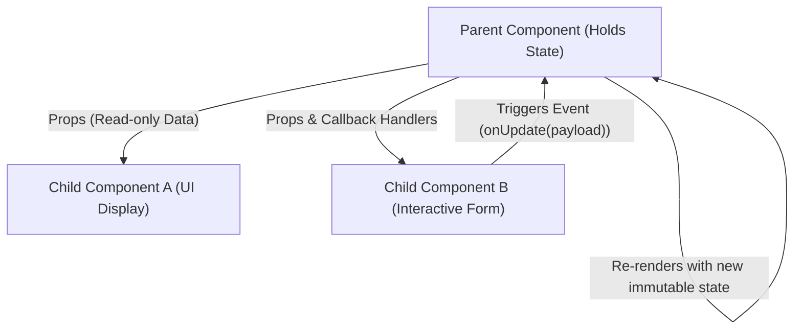

<!-- 10-react-ts-fundamentals-props-state.md -->
# 3.1 Modern React & TypeScript Fundamentals: Components, Props & State

## Learning Objectives
- Architect strictly-typed React components using TypeScript interfaces and type aliases.
- Master unidirectional data flow: Props down, Events up.
- Understand the React 18 Virtual DOM reconciliation algorithm and immutable state management.
- Prevent unnecessary re-renders by structuring component hierarchies cleanly.

---

## 1. Unidirectional Data Flow & Component Architecture

React follows a strict unidirectional data flow. State lives in a single source of truth and cascades down to child components via `props`. When an interaction occurs, children trigger callbacks that request parent state updates.



---

## 2. Typing Props, Children & State in TypeScript

In modern React with TypeScript, prefer `interface` or `type` for prop definitions rather than `React.FC` to maintain clean generics and standard typing.

```tsx
// src/components/Badge.tsx
import React from 'react';

export type BadgeVariant = 'success' | 'warning' | 'danger' | 'info';

export interface BadgeProps {
  label: string;
  variant?: BadgeVariant;
  count?: number;
  icon?: React.ReactNode;
}

export function Badge({ label, variant = 'info', count, icon }: BadgeProps) {
  const variantStyles: Record<BadgeVariant, string> = {
    success: 'bg-emerald-100 text-emerald-800 border-emerald-300',
    warning: 'bg-amber-100 text-amber-800 border-amber-300',
    danger: 'bg-rose-100 text-rose-800 border-rose-300',
    info: 'bg-blue-100 text-blue-800 border-blue-300',
  };

  return (
    <span className={`inline-flex items-center gap-1.5 px-2.5 py-0.5 rounded-full text-xs font-semibold border ${variantStyles[variant]}`}>
      {icon && <span className="w-3.5 h-3.5 flex items-center justify-center">{icon}</span>}
      <span>{label}</span>
      {typeof count === 'number' && (
        <span className="ml-1 px-1.5 py-0.2 rounded-full bg-white bg-opacity-70 text-[10px]">
          {count}
        </span>
      )}
    </span>
  );
}
```

---

## 3. Complete Code Example: Interactive Item List with Strict Typing

Below is an interactive product selection component showcasing immutable state transitions and typed callbacks:

```tsx
// src/components/ProductCatalog.tsx
import React, { useState } from 'react';

export interface ProductItem {
  id: string;
  sku: string;
  title: string;
  price: number;
  availableStock: number;
}

export interface ProductCatalogProps {
  initialProducts: ProductItem[];
  onCheckout: (selectedItems: { item: ProductItem; quantity: number }[]) => void;
}

export function ProductCatalog({ initialProducts, onCheckout }: ProductCatalogProps) {
  const [products] = useState<ProductItem[]>(initialProducts);
  const [cart, setCart] = useState<Record<string, number>>({});

  const handleAddToCart = (productId: string) => {
    setCart((prevCart) => {
      const currentQty = prevCart[productId] ?? 0;
      return {
        ...prevCart,
        [productId]: currentQty + 1,
      };
    });
  };

  const handleRemoveFromCart = (productId: string) => {
    setCart((prevCart) => {
      const currentQty = prevCart[productId] ?? 0;
      if (currentQty <= 1) {
        const copy = { ...prevCart };
        delete copy[productId];
        return copy;
      }
      return {
        ...prevCart,
        [productId]: currentQty - 1,
      };
    });
  };

  const totalCartCount = Object.values(cart).reduce((sum, qty) => sum + qty, 0);
  const totalCartValue = Object.entries(cart).reduce((sum, [id, qty]) => {
    const prod = products.find((p) => p.id === id);
    return sum + (prod ? prod.price * qty : 0);
  }, 0);

  const handleProceedToCheckout = () => {
    const items = Object.entries(cart)
      .map(([id, quantity]) => {
        const item = products.find((p) => p.id === id);
        return item ? { item, quantity } : null;
      })
      .filter((entry): entry is { item: ProductItem; quantity: number } => entry !== null);

    onCheckout(items);
  };

  return (
    <div className="max-w-4xl mx-auto p-6 bg-white rounded-xl shadow-md border border-slate-200">
      <div className="flex justify-between items-center mb-6 pb-4 border-b border-slate-100">
        <h2 className="text-2xl font-bold text-slate-800">Product Catalog</h2>
        <div className="text-sm font-medium text-slate-600">
          Cart: <span className="font-bold text-indigo-600">{totalCartCount} items</span> ({totalCartValue.toLocaleString('en-US', { style: 'currency', currency: 'USD' })})
        </div>
      </div>

      <div className="grid grid-cols-1 md:grid-cols-2 gap-4">
        {products.map((product) => {
          const qtyInCart = cart[product.id] ?? 0;
          const isMaxStock = qtyInCart >= product.availableStock;

          return (
            <div key={product.id} className="p-4 border border-slate-200 rounded-lg flex flex-col justify-between">
              <div>
                <div className="flex justify-between items-start">
                  <h3 className="font-semibold text-slate-800">{product.title}</h3>
                  <span className="text-xs font-mono bg-slate-100 text-slate-600 px-2 py-0.5 rounded">
                    {product.sku}
                  </span>
                </div>
                <p className="text-indigo-600 font-bold mt-2">
                  {product.price.toLocaleString('en-US', { style: 'currency', currency: 'USD' })}
                </p>
                <p className="text-xs text-slate-500 mt-1">
                  Available in stock: {product.availableStock}
                </p>
              </div>

              <div className="flex items-center gap-2 mt-4 pt-3 border-t border-slate-100">
                <button
                  type="button"
                  onClick={() => handleRemoveFromCart(product.id)}
                  disabled={qtyInCart === 0}
                  className="px-3 py-1 bg-slate-100 hover:bg-slate-200 disabled:opacity-40 rounded text-slate-700 font-bold"
                >
                  -
                </button>
                <span className="font-semibold text-slate-800 min-w-[24px] text-center">
                  {qtyInCart}
                </span>
                <button
                  type="button"
                  onClick={() => handleAddToCart(product.id)}
                  disabled={isMaxStock}
                  className="px-3 py-1 bg-indigo-600 hover:bg-indigo-700 disabled:opacity-40 text-white rounded font-bold"
                >
                  +
                </button>
              </div>
            </div>
          );
        })}
      </div>

      <div className="mt-6 flex justify-end">
        <button
          type="button"
          onClick={handleProceedToCheckout}
          disabled={totalCartCount === 0}
          className="px-6 py-2.5 bg-emerald-600 hover:bg-emerald-700 disabled:opacity-40 text-white font-medium rounded-lg transition"
        >
          Proceed to Checkout ({totalCartValue.toLocaleString('en-US', { style: 'currency', currency: 'USD' })})
        </button>
      </div>
    </div>
  );
}
```

---

## 4. Key Takeaways
1. Always treat state in React as **strictly immutable**; never mutate arrays or objects directly (`cart[id] = 1` is invalid). Always spread into a new object: `{ ...prev, [id]: qty }`.
2. Model typed prop contracts explicitly using TypeScript interfaces.
3. Keep UI presentation components decoupled from networking; emit events upward via callback functions.
