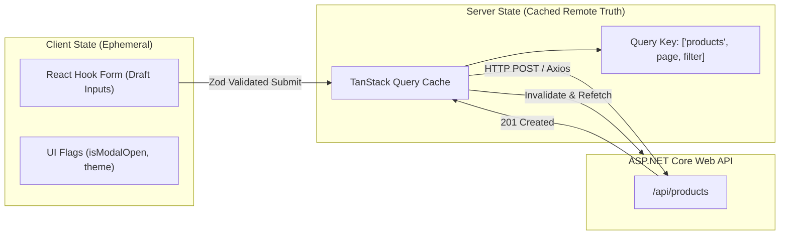

<!-- 12-react-forms-zod-tanstack-query.md -->
# 3.3 Form Handling (React Hook Form + Zod) & Server State (TanStack Query)

## Learning Objectives
- Master form handling using **React Hook Form** to minimize re-renders via uncontrolled inputs.
- Enforce schema validation and infer TypeScript types using **Zod**.
- Configure **Axios** with global interceptors for Bearer token authorization and error mapping.
- Orchestrate server state caching, background refetching, and optimistic mutations with **TanStack Query v5**.

---

## 1. Client State vs. Server State Architecture



---

## 2. Axios Client Configuration with Interceptors

```typescript
// src/api/apiClient.ts
import axios, { AxiosError, InternalAxiosRequestConfig } from 'axios';

export const apiClient = axios.create({
  baseURL: import.meta.env.VITE_API_BASE_URL || 'http://localhost:5000/api',
  headers: {
    'Content-Type': 'application/json',
  },
  timeout: 10000,
});

// Request Interceptor: Injects JWT Bearer token if present in localStorage
apiClient.interceptors.request.use(
  (config: InternalAxiosRequestConfig) => {
    const token = localStorage.getItem('access_token');
    if (token && config.headers) {
      config.headers.Authorization = `Bearer ${token}`;
    }
    return config;
  },
  (error: AxiosError) => Promise.reject(error)
);

// Response Interceptor: Formats RFC 7807 problem details
apiClient.interceptors.response.use(
  (response) => response,
  (error: AxiosError) => {
    if (error.response?.status === 401) {
      // Clear token and redirect to login if unauthorized
      localStorage.removeItem('access_token');
    }
    return Promise.reject(error);
  }
);
```

---

## 3. Form Validation with React Hook Form & Zod

```typescript
// src/schemas/productSchema.ts
import { z } from 'zod';

export const productFormSchema = z.object({
  sku: z
    .string()
    .min(3, 'SKU must be at least 3 characters')
    .max(16, 'SKU cannot exceed 16 characters')
    .regex(/^[A-Z0-9-]+$/, 'SKU must contain only uppercase letters, numbers, and hyphens'),
  name: z
    .string()
    .min(3, 'Product name is required')
    .max(120, 'Product name cannot exceed 120 characters'),
  price: z
    .coerce
    .number()
    .positive('Price must be greater than zero')
    .max(100000, 'Price cannot exceed $100,000'),
  initialStock: z
    .coerce
    .number()
    .int('Stock must be an integer')
    .min(0, 'Stock cannot be negative'),
});

// Infer TypeScript type directly from the Zod schema
export type ProductFormData = z.infer<typeof productFormSchema>;
```

---

## 4. Complete Code Example: Form Component with TanStack Query Mutation

```tsx
// src/components/CreateProductForm.tsx
import React from 'react';
import { useForm } from 'react-hook-form';
import { zodResolver } from '@hookform/resolvers/zod';
import { useMutation, useQueryClient } from '@tanstack/react-query';
import { productFormSchema, ProductFormData } from '../schemas/productSchema';
import { apiClient } from '../api/apiClient';

export interface ProductResponse {
  id: string;
  sku: string;
  name: string;
  price: number;
  stockQuantity: number;
}

export function CreateProductForm({ onSuccess }: { onSuccess?: () => void }) {
  const queryClient = useQueryClient();

  const {
    register,
    handleSubmit,
    reset,
    formState: { errors, isSubmitting },
  } = useForm<ProductFormData>({
    resolver: zodResolver(productFormSchema),
    defaultValues: {
      sku: '',
      name: '',
      price: 0,
      initialStock: 0,
    },
  });

  const createProductMutation = useMutation({
    mutationFn: async (formData: ProductFormData) => {
      const response = await apiClient.post<ProductResponse>('/products', formData);
      return response.data;
    },
    onSuccess: () => {
      // Invalidate the cache to trigger an immediate background refresh of the products list
      queryClient.invalidateQueries({ queryKey: ['products'] });
      reset();
      if (onSuccess) {
        onSuccess();
      }
    },
  });

  const onSubmit = (data: ProductFormData) => {
    createProductMutation.mutate(data);
  };

  return (
    <form
      onSubmit={handleSubmit(onSubmit)}
      className="p-6 bg-white rounded-lg shadow-sm border border-slate-200 max-w-lg space-y-4"
    >
      <h3 className="text-lg font-semibold text-slate-800">Create New Product</h3>

      {createProductMutation.isError && (
        <div className="p-3 bg-rose-50 border border-rose-200 text-rose-700 text-sm rounded">
          Failed to create product: {createProductMutation.error.message}
        </div>
      )}

      <div>
        <label htmlFor="sku" className="block text-xs font-semibold text-slate-700 uppercase mb-1">
          SKU
        </label>
        <input
          id="sku"
          type="text"
          {...register('sku')}
          className="w-full px-3 py-2 border rounded-md text-sm border-slate-300 focus:ring-2 focus:ring-indigo-500"
          placeholder="PROD-001"
        />
        {errors.sku && <p className="text-xs text-rose-600 mt-1">{errors.sku.message}</p>}
      </div>

      <div>
        <label htmlFor="name" className="block text-xs font-semibold text-slate-700 uppercase mb-1">
          Product Name
        </label>
        <input
          id="name"
          type="text"
          {...register('name')}
          className="w-full px-3 py-2 border rounded-md text-sm border-slate-300 focus:ring-2 focus:ring-indigo-500"
          placeholder="Wireless Noise-Cancelling Headphones"
        />
        {errors.name && <p className="text-xs text-rose-600 mt-1">{errors.name.message}</p>}
      </div>

      <div className="grid grid-cols-2 gap-4">
        <div>
          <label htmlFor="price" className="block text-xs font-semibold text-slate-700 uppercase mb-1">
            Price ($)
          </label>
          <input
            id="price"
            type="number"
            step="0.01"
            {...register('price')}
            className="w-full px-3 py-2 border rounded-md text-sm border-slate-300 focus:ring-2 focus:ring-indigo-500"
          />
          {errors.price && <p className="text-xs text-rose-600 mt-1">{errors.price.message}</p>}
        </div>

        <div>
          <label htmlFor="initialStock" className="block text-xs font-semibold text-slate-700 uppercase mb-1">
            Stock Qty
          </label>
          <input
            id="initialStock"
            type="number"
            {...register('initialStock')}
            className="w-full px-3 py-2 border rounded-md text-sm border-slate-300 focus:ring-2 focus:ring-indigo-500"
          />
          {errors.initialStock && (
            <p className="text-xs text-rose-600 mt-1">{errors.initialStock.message}</p>
          )}
        </div>
      </div>

      <button
        type="submit"
        disabled={isSubmitting || createProductMutation.isPending}
        className="w-full py-2.5 px-4 bg-indigo-600 hover:bg-indigo-700 disabled:opacity-50 text-white font-medium text-sm rounded-md transition"
      >
        {createProductMutation.isPending ? 'Saving Product...' : 'Create Product'}
      </button>
    </form>
  );
}
```

---

## 5. Key Takeaways
1. **React Hook Form** avoids component re-renders on keystrokes by managing inputs through DOM references.
2. **Zod** provides a single source of truth for runtime validation and static TypeScript types.
3. **TanStack Query** acts as a declarative cache manager, abstracting deduplication, retry logic, and cache invalidation.
