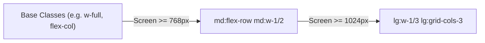

<!-- 13-react-tailwind-responsive-design.md -->
# 3.4 Component Styling with Tailwind CSS & Responsive Layout Strategies

## Learning Objectives
- Master the utility-first methodology with Tailwind CSS and the Just-in-Time (JIT) compiler.
- Implement mobile-first responsive breakpoints (`sm:`, `md:`, `lg:`, `xl:`).
- Build production layout structures using CSS Grid, Flexbox, and sticky positioning.
- Implement dark mode toggling using the `class` strategy and ensure WCAG-compliant accessible contrast and focus rings.

---

## 1. Tailwind Responsive Breakpoint Matrix

Tailwind operates on a strict **mobile-first** media query paradigm:

| Prefix | Minimum Width (`min-width`) | Target Device Classification |
| :--- | :--- | :--- |
| *(default)* | `0px` | Mobile portrait & small screens |
| `sm:` | `640px` | Large smartphones / phablets |
| `md:` | `768px` | Tablets & small laptops |
| `lg:` | `1024px` | Standard desktop displays |
| `xl:` | `1280px` | Large desktop monitors |
| `2xl:` | `1536px` | Ultra-wide monitors |



---

## 2. Complete Code Example: Responsive Application Shell

Below is a complete, production-grade Responsive Shell with a collapsible sidebar, header with dark mode toggle, and responsive metrics grid:

```tsx
// src/components/AppLayoutShell.tsx
import React, { useState, useEffect } from 'react';

export interface AppLayoutShellProps {
  children: React.ReactNode;
}

export function AppLayoutShell({ children }: AppLayoutShellProps) {
  const [isSidebarOpen, setIsSidebarOpen] = useState(false);
  const [isDarkMode, setIsDarkMode] = useState(false);

  useEffect(() => {
    if (isDarkMode) {
      document.documentElement.classList.add('dark');
    } else {
      document.documentElement.classList.remove('dark');
    }
  }, [isDarkMode]);

  return (
    <div className="min-h-screen bg-slate-50 dark:bg-slate-950 text-slate-900 dark:text-slate-100 flex flex-col transition-colors duration-200">
      {/* Top Navigation Bar */}
      <header className="sticky top-0 z-40 bg-white dark:bg-slate-900 border-b border-slate-200 dark:border-slate-800 px-4 py-3 flex items-center justify-between shadow-sm">
        <div className="flex items-center gap-3">
          {/* Mobile hamburger menu toggle */}
          <button
            type="button"
            onClick={() => setIsSidebarOpen((prev) => !prev)}
            aria-label="Toggle Navigation Menu"
            className="md:hidden p-2 rounded-lg text-slate-600 dark:text-slate-300 hover:bg-slate-100 dark:hover:bg-slate-800 focus:outline-none focus:ring-2 focus:ring-indigo-500"
          >
            <svg className="w-6 h-6" fill="none" stroke="currentColor" viewBox="0 0 24 24">
              <path strokeLinecap="round" strokeLinejoin="round" strokeWidth={2} d="M4 6h16M4 12h16M4 18h16" />
            </svg>
          </button>
          <span className="text-lg font-black tracking-tight text-indigo-600 dark:text-indigo-400">
            PROD<span className="text-slate-900 dark:text-white">API</span>
          </span>
        </div>

        <div className="flex items-center gap-3">
          <button
            type="button"
            onClick={() => setIsDarkMode((prev) => !prev)}
            className="p-2 rounded-lg border border-slate-200 dark:border-slate-700 bg-slate-100 dark:bg-slate-800 text-xs font-semibold hover:bg-slate-200 dark:hover:bg-slate-700 transition"
          >
            {isDarkMode ? '☀️ Light' : '🌙 Dark'}
          </button>

          <div className="w-8 h-8 rounded-full bg-indigo-600 text-white font-bold text-xs flex items-center justify-center">
            AD
          </div>
        </div>
      </header>

      <div className="flex-1 flex overflow-hidden">
        {/* Responsive Drawer / Desktop Sidebar */}
        <aside
          className={`fixed inset-y-0 left-0 z-30 w-64 bg-white dark:bg-slate-900 border-r border-slate-200 dark:border-slate-800 transform transition-transform duration-300 ease-in-out md:static md:translate-x-0 ${
            isSidebarOpen ? 'translate-x-0' : '-translate-x-full'
          }`}
        >
          <div className="p-4 space-y-1">
            <a
              href="#dashboard"
              className="flex items-center gap-3 px-3 py-2 text-sm font-medium rounded-lg bg-indigo-50 dark:bg-indigo-950/50 text-indigo-700 dark:text-indigo-300"
            >
              📊 Dashboard
            </a>
            <a
              href="#inventory"
              className="flex items-center gap-3 px-3 py-2 text-sm font-medium rounded-lg text-slate-600 dark:text-slate-400 hover:bg-slate-100 dark:hover:bg-slate-800"
            >
              📦 Inventory
            </a>
            <a
              href="#orders"
              className="flex items-center gap-3 px-3 py-2 text-sm font-medium rounded-lg text-slate-600 dark:text-slate-400 hover:bg-slate-100 dark:hover:bg-slate-800"
            >
              📑 Orders
            </a>
            <a
              href="#settings"
              className="flex items-center gap-3 px-3 py-2 text-sm font-medium rounded-lg text-slate-600 dark:text-slate-400 hover:bg-slate-100 dark:hover:bg-slate-800"
            >
              ⚙️ Settings
            </a>
          </div>
        </aside>

        {/* Overlay backdrop for mobile */}
        {isSidebarOpen && (
          <div
            onClick={() => setIsSidebarOpen(false)}
            className="fixed inset-0 z-20 bg-black/40 backdrop-blur-sm md:hidden"
          />
        )}

        {/* Main Content Area */}
        <main className="flex-1 overflow-y-auto p-4 md:p-8 max-w-7xl mx-auto w-full">
          {children}
        </main>
      </div>
    </div>
  );
}
```

---

## 3. Key Takeaways
1. Always start designs with **mobile styling first**; then apply `md:` and `lg:` overrides.
2. Utilize Tailwind's `dark:` variant combined with `class` based switching in `tailwind.config.js`.
3. Provide explicit focus indicators (`focus:ring-2 focus:ring-indigo-500`) to guarantee keyboard navigation accessibility.
