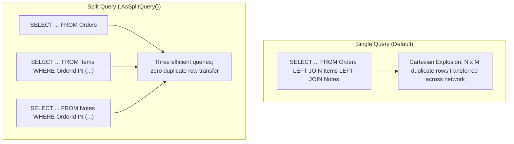

<!-- 16-adv-aspnet-efcore-performance-auditing.md -->
# 4.2 Advanced EF Core: Performance Tuning, Soft Deletes & Audit Logging

## Learning Objectives
- Diagnose and eliminate Cartesian product explosion in complex relational queries using `AsSplitQuery()`.
- Eliminate query compilation overhead on hot paths using **Compiled Queries** (`EF.CompileAsyncQuery`).
- Implement transparent Soft Deletes using EF Core **Global Query Filters** and learn how to bypass them when auditing.
- Automate temporal audit logging (`CreatedBy`, `CreatedAtUtc`, `LastModifiedBy`, `LastModifiedAtUtc`) by intercepting `SaveChangesAsync`.

---

## 1. Cartesian Product Explosion vs. Split Queries

When executing a LINQ query with multiple `.Include()` statements on collections (e.g. `Order` -> `OrderItems` and `Order` -> `OrderNotes`), EF Core generates a massive relational SQL `LEFT JOIN`. If an order has 20 items and 10 notes, the database returns 200 rows with duplicated order data.



---

## 2. Global Query Filters & Soft Delete Architecture

Instead of hard-deleting records from tables (`DELETE FROM ...`), enterprise systems mark records with `IsDeleted = true` and `DeletedAtUtc`.

```csharp
namespace Module04.Data.Common;

public interface ISoftDeletable
{
    bool IsDeleted { get; set; }
    DateTime? DeletedAtUtc { get; set; }
}

public interface IAuditableEntity
{
    DateTime CreatedAtUtc { get; set; }
    string CreatedBy { get; set; }
    DateTime? LastModifiedAtUtc { get; set; }
    string? LastModifiedBy { get; set; }
}
```

---

## 3. Complete Implementation: Auditable DbContext with Soft Deletes & Compiled Queries

```csharp
namespace Module04.Data;

using Microsoft.EntityFrameworkCore;
using Module04.Data.Common;

public sealed class Document : ISoftDeletable, IAuditableEntity
{
    public Guid Id { get; set; }
    public string Title { get; set; } = string.Empty;
    public string Content { get; set; } = string.Empty;
    public Guid AuthorId { get; set; }

    // Soft delete properties
    public bool IsDeleted { get; set; }
    public DateTime? DeletedAtUtc { get; set; }

    // Audit properties
    public DateTime CreatedAtUtc { get; set; }
    public string CreatedBy { get; set; } = string.Empty;
    public DateTime? LastModifiedAtUtc { get; set; }
    public string? LastModifiedBy { get; set; }
}

public interface ICurrentUserService
{
    string GetCurrentUserId();
}

public sealed class AdvancedEnterpriseDbContext : DbContext
{
    private readonly ICurrentUserService _currentUserService;

    public DbSet<Document> Documents => Set<Document>();

    public AdvancedEnterpriseDbContext(
        DbContextOptions<AdvancedEnterpriseDbContext> options,
        ICurrentUserService currentUserService) : base(options)
    {
        _currentUserService = currentUserService;
    }

    protected override void OnModelCreating(ModelBuilder modelBuilder)
    {
        base.OnModelCreating(modelBuilder);

        modelBuilder.Entity<Document>(entity =>
        {
            entity.HasKey(d => d.Id);
            entity.Property(d => d.Title).IsRequired().HasMaxLength(200);

            // 1. Global Query Filter for Soft Delete
            entity.HasQueryFilter(d => !d.IsDeleted);

            // Index for fast query execution with filter
            entity.HasIndex(d => new { d.IsDeleted, d.AuthorId });
        });
    }

    // 2. Automated Temporal Audit Interception
    public override Task<int> SaveChangesAsync(CancellationToken cancellationToken = default)
    {
        var currentUserId = _currentUserService.GetCurrentUserId();
        var utcNow = DateTime.UtcNow;

        foreach (var entry in ChangeTracker.Entries())
        {
            if (entry.Entity is IAuditableEntity auditable)
            {
                if (entry.State == EntityState.Added)
                {
                    auditable.CreatedAtUtc = utcNow;
                    auditable.CreatedBy = currentUserId;
                }
                else if (entry.State == EntityState.Modified)
                {
                    auditable.LastModifiedAtUtc = utcNow;
                    auditable.LastModifiedBy = currentUserId;
                }
            }

            // Intercept soft deletes: convert hard DELETE to soft update
            if (entry.Entity is ISoftDeletable softDeletable && entry.State == EntityState.Deleted)
            {
                entry.State = EntityState.Modified;
                softDeletable.IsDeleted = true;
                softDeletable.DeletedAtUtc = utcNow;
            }
        }

        return base.SaveChangesAsync(cancellationToken);
    }
}
```

---

## 4. High-Performance Hot Paths: Compiled Queries

When an endpoint executes hundreds of thousands of times per minute with identical query shapes, query compilation represents significant CPU overhead. `EF.CompileAsyncQuery` compiles the LINQ expression tree to SQL once and caches the execution delegate.

```csharp
namespace Module04.Data.Performance;

using Microsoft.EntityFrameworkCore;
using Module04.Data;

public static class DocumentQueries
{
    // Pre-compiled query cached in memory
    private static readonly Func<AdvancedEnterpriseDbContext, Guid, Task<Document?>> GetByIdCompiled =
        EF.CompileAsyncQuery((AdvancedEnterpriseDbContext context, Guid id) =>
            context.Documents
                .AsNoTracking()
                .FirstOrDefault(d => d.Id == id));

    public static async Task<Document?> GetDocumentFastAsync(AdvancedEnterpriseDbContext db, Guid documentId)
    {
        return await GetByIdCompiled(db, documentId);
    }

    // Query that intentionally reads archived / soft-deleted documents
    public static async Task<List<Document>> GetArchivedDocumentsAsync(AdvancedEnterpriseDbContext db)
    {
        return await db.Documents
            .IgnoreQueryFilters() // Bypasses the !IsDeleted global query filter!
            .Where(d => d.IsDeleted)
            .AsNoTracking()
            .ToListAsync();
    }
}
```

---

## 5. Key Takeaways
1. Use `.AsSplitQuery()` when including multiple collection navigations to prevent exponential Cartesian row growth.
2. Intercept `SaveChangesAsync()` to ensure audit properties and soft-delete conversions are applied uniformly across the application.
3. Use `IgnoreQueryFilters()` whenever administrative or audit tasks require querying soft-deleted records.
4. Hot lookup paths benefit significantly from pre-compiled `EF.CompileAsyncQuery` delegates.
