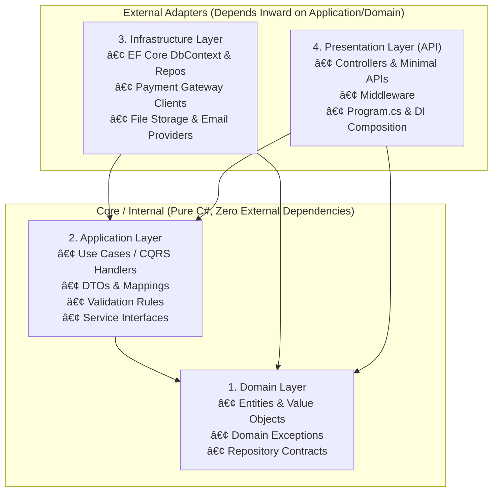

<!-- 17-adv-aspnet-clean-architecture.md -->
# 4.3 Clean Architecture & Onion Architecture in .NET

## Learning Objectives
- Architect enterprise .NET solutions following the strict **Dependency Inversion Principle (DIP)**.
- Isolate Domain, Application, Infrastructure, and Presentation layers into separate assemblies.
- Ensure outer layers depend inward on contracts, preventing database and framework concerns from polluting business logic.
- Implement a decoupled Command Query Responsibility Segregation (CQRS) flow.

---

## 1. Clean Architecture Onion Topology



### The Inward Dependency Rule

| Layer | Responsibility | Allowed Project References |
| :--- | :--- | :--- |
| **Domain** | Business entities, rules, and value objects | **None** (Pure .NET standard library) |
| **Application** | Use cases, CQRS commands/queries, interfaces | **Domain** only |
| **Infrastructure** | EF Core, external third-party APIs, disk I/O | **Application**, **Domain** |
| **Presentation (API)** | HTTP endpoints, serialization, middleware | **Application**, **Infrastructure** (Composition root only) |

---

## 2. Complete Layer Implementation Example

### 1. Domain Layer (`CleanArch.Domain`)

```csharp
namespace CleanArch.Domain.Entities;

public sealed class BankAccount
{
    public Guid Id { get; private set; }
    public string AccountNumber { get; private set; }
    public string OwnerEmail { get; private set; }
    public decimal Balance { get; private set; }

    public BankAccount(Guid id, string accountNumber, string ownerEmail, decimal initialDeposit)
    {
        if (initialDeposit < 0)
            throw new ArgumentException("Initial deposit cannot be negative.", nameof(initialDeposit));

        Id = id;
        AccountNumber = accountNumber ?? throw new ArgumentNullException(nameof(accountNumber));
        OwnerEmail = ownerEmail ?? throw new ArgumentNullException(nameof(ownerEmail));
        Balance = initialDeposit;
    }

    public void Deposit(decimal amount)
    {
        if (amount <= 0)
            throw new InvalidOperationException("Deposit amount must be strictly positive.");

        Balance += amount;
    }

    public void Withdraw(decimal amount)
    {
        if (amount <= 0)
            throw new InvalidOperationException("Withdrawal amount must be strictly positive.");

        if (Balance - amount < 0)
            throw new InvalidOperationException($"Insufficient funds. Available balance: {Balance:C}");

        Balance -= amount;
    }
}

namespace CleanArch.Domain.Repositories;

using CleanArch.Domain.Entities;

public interface IBankAccountRepository
{
    Task<BankAccount?> GetByIdAsync(Guid id, CancellationToken ct = default);
    Task<BankAccount?> GetByAccountNumberAsync(string accountNumber, CancellationToken ct = default);
    Task AddAsync(BankAccount account, CancellationToken ct = default);
    Task UpdateAsync(BankAccount account, CancellationToken ct = default);
}
```

### 2. Application Layer (`CleanArch.Application`)

```csharp
namespace CleanArch.Application.Accounts.Commands;

using CleanArch.Domain.Repositories;

// Command and Handler
public sealed record TransferFundsCommand(string FromAccountNumber, string ToAccountNumber, decimal Amount);
public sealed record TransferFundsResult(bool Success, string TransactionReference, decimal NewSourceBalance);

public interface ITransferFundsUseCase
{
    Task<TransferFundsResult> ExecuteAsync(TransferFundsCommand command, CancellationToken ct = default);
}

public sealed class TransferFundsUseCase : ITransferFundsUseCase
{
    private readonly IBankAccountRepository _accountRepository;

    public TransferFundsUseCase(IBankAccountRepository accountRepository)
    {
        _accountRepository = accountRepository;
    }

    public async Task<TransferFundsResult> ExecuteAsync(TransferFundsCommand command, CancellationToken ct = default)
    {
        if (command.Amount <= 0)
        {
            throw new ArgumentException("Transfer amount must be positive.", nameof(command.Amount));
        }

        var source = await _accountRepository.GetByAccountNumberAsync(command.FromAccountNumber, ct)
            ?? throw new KeyNotFoundException($"Source account '{command.FromAccountNumber}' not found.");

        var destination = await _accountRepository.GetByAccountNumberAsync(command.ToAccountNumber, ct)
            ?? throw new KeyNotFoundException($"Destination account '{command.ToAccountNumber}' not found.");

        // Execute Domain Logic
        source.Withdraw(command.Amount);
        destination.Deposit(command.Amount);

        // Persist Changes
        await _accountRepository.UpdateAsync(source, ct);
        await _accountRepository.UpdateAsync(destination, ct);

        return new TransferFundsResult(
            Success: true,
            TransactionReference: $"TRX-{Guid.NewGuid():N}",
            NewSourceBalance: source.Balance);
    }
}
```

### 3. Infrastructure Layer (`CleanArch.Infrastructure`)

```csharp
namespace CleanArch.Infrastructure.Persistence;

using System.Collections.Concurrent;
using CleanArch.Domain.Entities;
using CleanArch.Domain.Repositories;

// Production applications would use EF Core DbContext here
public sealed class InMemoryBankAccountRepository : IBankAccountRepository
{
    private static readonly ConcurrentDictionary<string, BankAccount> Store = new();

    public Task<BankAccount?> GetByIdAsync(Guid id, CancellationToken ct = default)
    {
        var match = Store.Values.FirstOrDefault(a => a.Id == id);
        return Task.FromResult(match);
    }

    public Task<BankAccount?> GetByAccountNumberAsync(string accountNumber, CancellationToken ct = default)
    {
        Store.TryGetValue(accountNumber, out var account);
        return Task.FromResult(account);
    }

    public Task AddAsync(BankAccount account, CancellationToken ct = default)
    {
        Store[account.AccountNumber] = account;
        return Task.CompletedTask;
    }

    public Task UpdateAsync(BankAccount account, CancellationToken ct = default)
    {
        Store[account.AccountNumber] = account;
        return Task.CompletedTask;
    }
}
```

### 4. Presentation API Layer (`CleanArch.Api`)

```csharp
// Program.cs in CleanArch.Api
using CleanArch.Application.Accounts.Commands;
using CleanArch.Domain.Entities;
using CleanArch.Domain.Repositories;
using CleanArch.Infrastructure.Persistence;

var builder = WebApplication.CreateBuilder(args);

// Wire up dependencies: DIP in practice
builder.Services.AddSingleton<IBankAccountRepository, InMemoryBankAccountRepository>();
builder.Services.AddScoped<ITransferFundsUseCase, TransferFundsUseCase>();

var app = builder.Build();

// Seed initial test accounts
var repo = app.Services.GetRequiredService<IBankAccountRepository>();
await repo.AddAsync(new BankAccount(Guid.NewGuid(), "ACC-1001", "alice@domain.com", 1500.00m));
await repo.AddAsync(new BankAccount(Guid.NewGuid(), "ACC-1002", "bob@domain.com", 300.00m));

// Minimal API mapping use case
app.MapPost("/api/accounts/transfer", async (TransferFundsCommand command, ITransferFundsUseCase useCase, CancellationToken ct) =>
{
    try
    {
        var result = await useCase.ExecuteAsync(command, ct);
        return Results.Ok(result);
    }
    catch (KeyNotFoundException ex)
    {
        return Results.NotFound(new { error = ex.Message });
    }
    catch (InvalidOperationException ex)
    {
        return Results.BadRequest(new { error = ex.Message });
    }
});

app.Run();
```

---

## 3. Key Takeaways
1. Clean Architecture ensures **business logic remains completely insulated** from changes to UI frameworks or database drivers.
2. The **Domain** contains business invariants; entities protect their state by exposing meaningful methods (`Deposit`, `Withdraw`) rather than public setters.
3. The **API Presentation layer** serves only as an adapter mapping HTTP requests into application commands/queries and serializing results back to the client.
