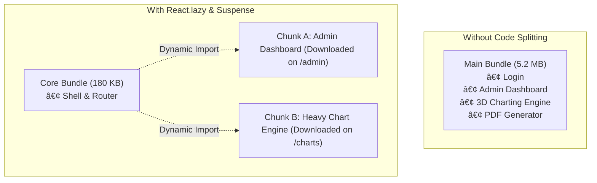
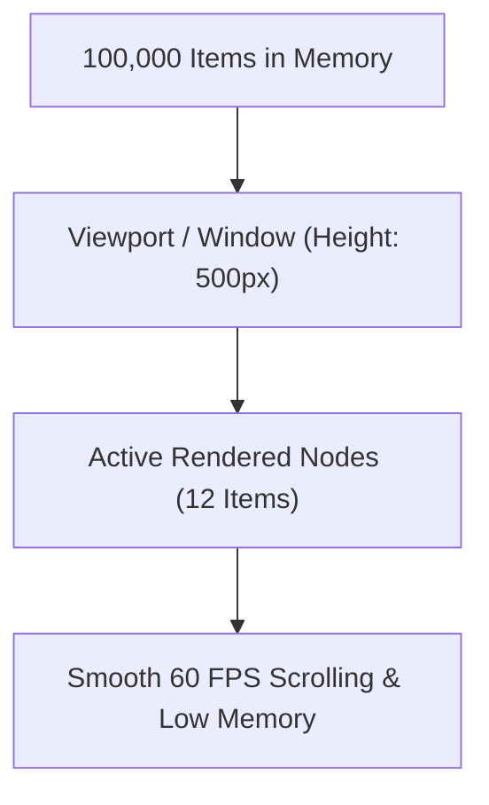

<!-- 22-adv-react-performance-virtualization.md -->
# 5.3 Performance Optimization: Code Splitting & Virtualization

## Learning Objectives
- Minimize initial JavaScript bundle payloads using **Route-Level and Component-Level Code Splitting** (`React.lazy`, `Suspense`).
- Render high-volume datasets (100,000+ rows) smoothly at 60 FPS using **List Virtualization**.
- Leverage `React.memo` with custom equality comparators to prevent costly re-renders.
- Profile and isolate layout shift and rendering bottlenecks using React Profiler.

---

## 1. Bundle Splitting Architecture: Lazy Loading & Suspense

Without code splitting, bundlers bundle all application code into one monolithic `index.js`. As features expand, initial download times spike, degrading First Contentful Paint (FCP) and Time to Interactive (TTI).



---

## 2. Dynamic Component Chunking with Fallbacks

```tsx
// src/components/LazyLoadWrapper.tsx
import React, { Suspense, lazy } from 'react';

// Lazy load heavy components
const HeavyAnalyticsChart = lazy(() => import('./HeavyAnalyticsChart'));
const PdfReportGenerator = lazy(() => import('./PdfReportGenerator'));

export function LazyAnalyticsView() {
  return (
    <div className="p-6 space-y-6">
      <h2 className="text-xl font-bold">Analytics & Reports</h2>

      <Suspense
        fallback={
          <div className="h-64 flex items-center justify-center bg-slate-100 rounded-lg animate-pulse text-slate-400">
            Loading interactive charting modules...
          </div>
        }
      >
        <HeavyAnalyticsChart />
      </Suspense>

      <Suspense
        fallback={
          <div className="h-24 flex items-center justify-center bg-slate-100 rounded-lg animate-pulse text-slate-400">
            Loading document generation engine...
          </div>
        }
      >
        <PdfReportGenerator />
      </Suspense>
    </div>
  );
}
```

---

## 3. High-Performance List Virtualization

Rendering thousands of DOM nodes causes memory spikes and UI freezing. Virtualization renders only the items currently inside the visible viewport:



### Complete Virtualized List Implementation

Below is a self-contained virtual list engine implemented without external dependencies:

```tsx
// src/components/VirtualizedDataGrid.tsx
import React, { useState, useRef, useMemo } from 'react';

export interface DataRow {
  id: string;
  code: string;
  description: string;
  timestamp: string;
}

export interface VirtualGridProps {
  items: DataRow[];
  rowHeight: number;
  viewportHeight: number;
}

export function VirtualizedDataGrid({ items, rowHeight, viewportHeight }: VirtualGridProps) {
  const [scrollTop, setScrollTop] = useState(0);
  const containerRef = useRef<HTMLDivElement>(null);

  const totalHeight = items.length * rowHeight;

  // Calculate slice indices
  const { startIndex, endIndex, offsetY } = useMemo(() => {
    const start = Math.max(0, Math.floor(scrollTop / rowHeight) - 2); // 2 rows buffer
    const visibleCount = Math.ceil(viewportHeight / rowHeight) + 4; // 4 rows buffer
    const end = Math.min(items.length, start + visibleCount);
    const offset = start * rowHeight;

    return { startIndex: start, endIndex: end, offsetY: offset };
  }, [scrollTop, rowHeight, viewportHeight, items.length]);

  const visibleItems = useMemo(
    () => items.slice(startIndex, endIndex),
    [items, startIndex, endIndex]
  );

  const handleScroll = (e: React.UIEvent<HTMLDivElement>) => {
    setScrollTop(e.currentTarget.scrollTop);
  };

  return (
    <div className="border border-slate-200 rounded-lg bg-white overflow-hidden shadow-xs">
      <div className="bg-slate-50 border-b px-4 py-2 font-bold text-xs uppercase text-slate-600 flex justify-between">
        <span>Log Record ID</span>
        <span>Status Timestamp</span>
      </div>

      <div
        ref={containerRef}
        onScroll={handleScroll}
        style={{ height: viewportHeight }}
        className="overflow-y-auto relative"
      >
        {/* Placeholder element to maintain full scrollable height */}
        <div style={{ height: totalHeight, width: '100%', position: 'relative' }}>
          {/* Rendered window translating vertically */}
          <div style={{ transform: `translateY(${offsetY}px)` }} className="absolute left-0 right-0 top-0">
            {visibleItems.map((row) => (
              <div
                key={row.id}
                style={{ height: rowHeight }}
                className="px-4 flex items-center justify-between border-b border-slate-100 hover:bg-slate-50 text-sm"
              >
                <div>
                  <span className="font-mono text-xs font-semibold text-indigo-600 mr-2">{row.code}</span>
                  <span className="text-slate-700">{row.description}</span>
                </div>
                <span className="text-xs text-slate-400 font-mono">{row.timestamp}</span>
              </div>
            ))}
          </div>
        </div>
      </div>

      <div className="p-2 bg-slate-50 border-t text-[11px] text-slate-500 text-right">
        Rendering rows {startIndex + 1} - {endIndex} of {items.length.toLocaleString()} total items
      </div>
    </div>
  );
}
```

---

## 4. Key Takeaways
1. Use **`React.lazy`** at router level boundaries to split application code by route.
2. Use **Virtualization** whenever displaying tables or lists containing more than 100 items.
3. Keep component state close to where it is used to avoid triggering wide re-render cascades.
