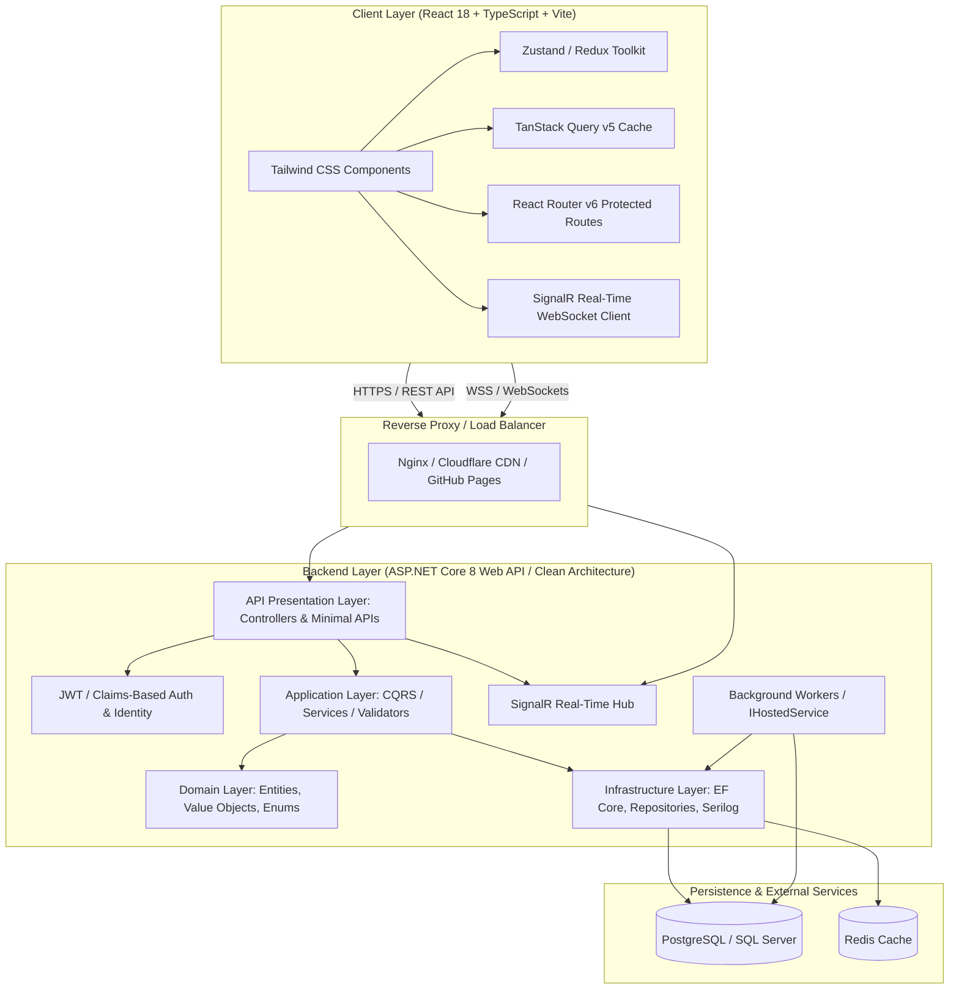

# Full-Stack Web Development: C#, ASP.NET Core Web API, and React (Zero to Production)

Welcome to **Full-Stack Web Development: C#, ASP.NET Core Web API, and React (Zero to Production)**, an industry-aligned, production-grade technical curriculum designed to transform software engineers into versatile full-stack architects.

---

## 🧭 Course Blueprint & Repository Architecture

This curriculum is structured as a live, publishable documentation portal deployable straight to **GitHub Pages** via Docsify or any standard static markdown viewer.

```text
.
├── .nojekyll                                # Prevents Jekyll processing on GitHub Pages
├── index.html                               # Docsify SPA entrypoint with Mermaid & PrismJS
├── _sidebar.md                              # Navigation hierarchy
├── README.md                                # Course homepage and overview
└── docs/
    ├── module-01-csharp-fundamentals/
    │   ├── 01-syntax-type-system-nullability.md
    │   ├── 02-oop-principles.md
    │   ├── 03-modern-csharp-linq-async.md
    │   └── 04-hands-on-exercise-solution.md
    ├── module-02-aspnet-core-webapi/
    │   ├── 01-architecture-di-pipeline.md
    │   ├── 02-routing-controllers-minimal-apis.md
    │   ├── 03-ef-core-repository-unit-of-work.md
    │   ├── 04-middleware-error-handling-serilog.md
    │   └── 05-hands-on-exercise-solution.md
    ├── module-03-modern-react-typescript/
    │   ├── 01-react-ts-fundamentals-props-state.md
    │   ├── 02-deep-dive-react-hooks.md
    │   ├── 03-forms-zod-tanstack-query.md
    │   ├── 04-tailwind-css-responsive-design.md
    │   └── 05-hands-on-exercise-solution.md
    ├── module-04-advanced-aspnet-core/
    │   ├── 01-jwt-auth-roles-claims-identity.md
    │   ├── 02-advanced-efcore-performance-auditing.md
    │   ├── 03-clean-architecture-onion.md
    │   ├── 04-signalr-and-background-workers.md
    │   └── 05-hands-on-exercise-solution.md
    ├── module-05-advanced-react-state/
    │   ├── 01-zustand-redux-toolkit.md
    │   ├── 02-react-router-v6-loaders-actions.md
    │   ├── 03-performance-code-splitting-virtualization.md
    │   ├── 04-realtime-signalr-react-client.md
    │   └── 05-hands-on-exercise-solution.md
    └── module-06-e2e-testing-deployment/
        ├── 01-full-stack-integration-project.md
        ├── 02-testing-xunit-moq-vitest-rtl.md
        ├── 03-ci-cd-github-actions-docker-deploy.md
        ├── 04-github-pages-publishing-guide.md
        └── 05-capstone-hands-on-solution.md
```

---

## 🏛️ End-to-End System Architecture

The following diagram captures the full-stack topology taught throughout this course:



---

## 📚 Module Overview

| Module | Level | Focus Areas | Key Deliverables |
| :--- | :--- | :--- | :--- |
| **Module 1** | Basic - Intermediate | C# Type System, OOP, Records, Pattern Matching, LINQ, Async/Await | In-Memory Order Processing Engine with async streams and pattern matching |
| **Module 2** | Intermediate | ASP.NET Core Web API, DI Lifetimes, Routing, EF Core Code-First, Serilog | Production REST API with SQLite/PostgreSQL, DTO validation, and custom middleware |
| **Module 3** | Basic - Intermediate | Modern React, TypeScript, Hooks in Depth, Zod, React Hook Form, TanStack Query | Responsive Dashboard with dynamic queries, optimistic UI mutations, and Tailwind |
| **Module 4** | Advanced | JWT & Refresh Tokens, Clean Architecture, EF Core Performance, SignalR, Hosted Services | Enterprise Clean Architecture solution with live notifications and scheduled batch tasks |
| **Module 5** | Advanced | Zustand State Management, React Router v6 Loaders, Webpack/Vite Code Splitting, SignalR Client | High-performance React enterprise workspace with real-time push data grid |
| **Module 6** | Production | Full-Stack Integration, xUnit & Moq, Vitest & RTL, Docker, GitHub Actions, GitHub Pages | Complete end-to-end multi-tier application with CI/CD pipelines and published course docs |

---

## 🛠️ Prerequisites & Local Development Setup

To follow this course, ensure your development workstation is equipped with:

1. **.NET SDK 8.0 or later**:
   ```bash
   dotnet --version
   ```
2. **Node.js (LTS version 20+) & npm / pnpm**:
   ```bash
   node --version
   npm --version
   ```
3. **Docker Desktop** (for running local PostgreSQL / SQL Server instances):
   ```bash
   docker --version
   ```
4. **IDE**:
   - Visual Studio 2022 (Community or higher) OR
   - Visual Studio Code with C# Dev Kit and React extensions.

---

## 🚀 How to Run the Documentation Locally

Because this curriculum uses Docsify, you can preview the documentation locally with any static HTTP server without a compilation step:

```bash
# Using Node's npx http-server
npx http-server . -p 3000

# OR using Python 3
python -m http.server 3000
```
Open your browser at `http://localhost:3000` to interactively view and navigate the entire course.
