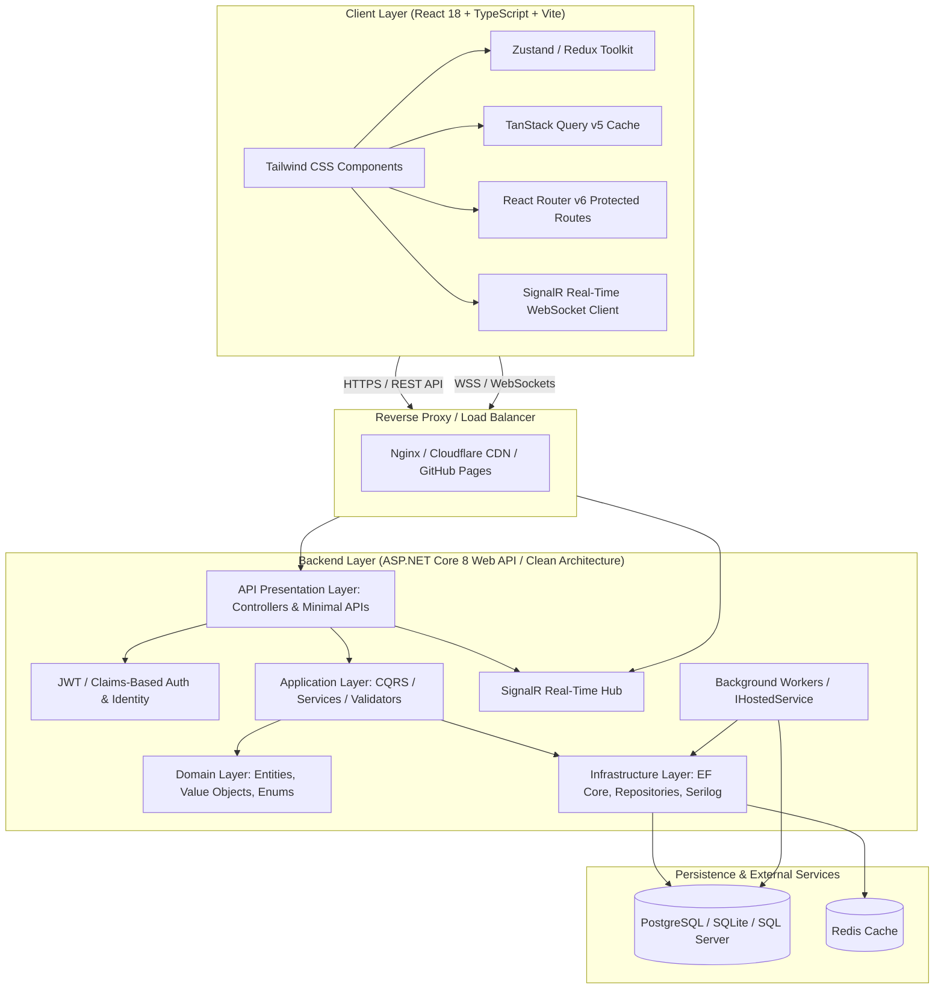

# Full-Stack Web Development: C#, ASP.NET Core Web API, and React (Zero to Production)

Welcome to **Full-Stack Web Development: C#, ASP.NET Core Web API, and React (Zero to Production)**, an industry-aligned, production-grade technical curriculum designed to transform software engineers into versatile full-stack architects.

---

## 🏛️ End-to-End System Architecture



---

## 📚 Curriculum Directory & Sequential Modules

### Module 1: C# Fundamentals & Object-Oriented Programming (Basic to Intermediate)
Master the foundation of modern C# development, memory mechanics, object-oriented architecture, functional data manipulation with LINQ, and non-blocking asynchronous programming.

* [01 - C# Syntax, Type System & Nullability](01-csharp-syntax-type-system-nullability.md): CTS, stack vs. heap memory, value vs. reference types, boxing/unboxing, and Nullable Reference Types (`?`, `??`, `??=`, `!`).
* [02 - Object-Oriented Programming in C#](02-csharp-oop-principles.md): Encapsulation, inheritance, polymorphism, abstraction, access modifiers, and extensible payment gateway design.
* [03 - Modern C#, LINQ & Async/Await](03-csharp-modern-linq-async.md): Positional records, pattern-matching expressions, deferred LINQ execution, `Task.WhenAll`, `IAsyncEnumerable<T>`, and exception filters.
* [04 - Module 1 Hands-On Lab & Solution](04-csharp-lab-solution.md): **Practical Lab**: In-memory asynchronous order valuation and risk mitigation engine.

---

### Module 2: Building RESTful APIs with ASP.NET Core Web API (Intermediate)
Architect production-grade backend APIs with dependency injection, model validation, Code-First database persistence, and standardized error handling.

* [05 - Web API Architecture, Program.cs & Dependency Injection](05-aspnet-architecture-di-pipeline.md): Web API anatomy, unified `Program.cs`, and DI lifetimes (`Transient`, `Scoped`, `Singleton`).
* [06 - Routing, Controllers, Minimal APIs & Validation](06-aspnet-routing-controllers-minimal-apis.md): REST routing constraints, Minimal APIs vs. Controllers, DTO patterns, and `FluentValidation`.
* [07 - Entity Framework Core, Relationships & Repository Pattern](07-aspnet-efcore-repository-unit-of-work.md): EF Core Code-First modeling, Fluent API relationships (1:1, 1:N, N:M), Repository and Unit of Work patterns.
* [08 - Middleware Pipeline, Global Errors & Serilog](08-aspnet-middleware-error-handling-serilog.md): Custom correlation ID middleware, RFC 7807 `ProblemDetails` exception handling, and structured JSON Serilog sinks.
* [09 - Module 2 Hands-On Lab & Solution](09-aspnet-lab-solution.md): **Practical Lab**: Production-grade Inventory REST API with SQLite, FluentValidation, and custom middleware.

---

### Module 3: Modern React with TypeScript (Basic to Intermediate)
Develop responsive frontend web applications with React 18, strict TypeScript contracts, advanced React hooks, zero-re-render form validations, and Tailwind CSS.

* [10 - React & TypeScript Fundamentals: Props & State](10-react-ts-fundamentals-props-state.md): Strict TypeScript props, immutable state updates, unidirectional data flow, and catalog item selection.
* [11 - Deep Dive into React Hooks](11-react-hooks-in-depth.md): Hooks in depth (`useState`, `useEffect` with `AbortController`, `useContext`, `useReducer`, `useMemo`, `useCallback`, and `useDebounce`).
* [12 - Form Handling (React Hook Form + Zod) & Server State (TanStack Query)](12-react-forms-zod-tanstack-query.md): Zero-re-render forms with `React Hook Form`, runtime schema validation via `Zod`, Axios interceptors, and TanStack Query mutations.
* [13 - Component Styling with Tailwind CSS & Responsive Layouts](13-react-tailwind-responsive-design.md): Mobile-first breakpoints, accessible application shells, drawer sidebars, and dark mode toggling.
* [14 - Module 3 Hands-On Lab & Solution](14-react-lab-solution.md): **Practical Lab**: Interactive Product & Stock Dashboard with modal forms and optimistic cache invalidation.

---

### Module 4: Advanced ASP.NET Core Features (Advanced)
Implement security and architectural patterns including token rotation, temporal auditing, Onion Architecture separation, and real-time WebSocket communication.

* [15 - JWT Authentication, Claims-Based Authorization & Refresh Tokens](15-adv-aspnet-jwt-auth-roles-identity.md): Stateless JWT issuance, cryptographic rotating refresh tokens, RBAC, and policy-based authorization.
* [16 - Advanced EF Core: Performance Tuning, Soft Deletes & Auditing](16-adv-aspnet-efcore-performance-auditing.md): Split queries (`AsSplitQuery`), pre-compiled queries (`EF.CompileAsyncQuery`), soft deletes via Global Query Filters, and automated temporal auditing.
* [17 - Clean Architecture & Onion Architecture in .NET](17-adv-aspnet-clean-architecture.md): Onion architecture separation (Domain, Application, Infrastructure, API) and CQRS use cases.
* [18 - Real-Time WebSockets with SignalR & Background Services](18-adv-aspnet-signalr-background-workers.md): Strongly-typed SignalR Hubs (`Hub<T>`), WebSocket rooms, and `BackgroundService` with `PeriodicTimer`.
* [19 - Module 4 Hands-On Lab & Solution](19-adv-aspnet-lab-solution.md): **Practical Lab**: Real-time order stream with JWT authorization, SignalR live broadcast, and background workers.

---

### Module 5: Advanced React & State Management (Advanced)
Optimize frontend architectures with lightweight atomic stores, pre-render data loading, list virtualization for large datasets, and live SignalR client streaming.

* [20 - Global State Management: Zustand vs. Redux Toolkit](20-adv-react-zustand-state-management.md): Atomic Zustand store slices, localStorage persistence, fine-grained selectors, and re-render benchmarks.
* [21 - Advanced Routing with React Router v6: Loaders & Protected Routes](21-adv-react-router-v6-loaders-routes.md): Data prefetching with route loaders, layout routes with `<Outlet />`, and role-based protected route guards.
* [22 - Performance Optimization: Code Splitting & Virtualization](22-adv-react-performance-virtualization.md): Code splitting with `React.lazy` and `Suspense`, and 60 FPS list virtualization engine.
* [23 - Real-Time Integration with SignalR in React](23-adv-react-signalr-client.md): Official `@microsoft/signalr` client integration, reconnection policies, and `useSignalRHub` custom hook.
* [24 - Module 5 Hands-On Lab & Solution](24-adv-react-lab-solution.md): **Practical Lab**: High-performance real-time trading terminal with Zustand and virtualized order book.

---

### Module 6: End-to-End Integration, Testing & Capstone (Production)
Unify frontend and backend systems with contracts, automated test suites (xUnit + Vitest), production Docker packaging, and an integrated real-time Capstone application.

* [25 - Production Full-Stack Integration Architecture](25-e2e-full-stack-integration-project.md): Monorepo setup, Vite dev proxy, and contract synchronization.
* [26 - Automated Testing: xUnit, Moq, Vitest & React Testing Library](26-e2e-testing-xunit-moq-vitest-rtl.md): Testing pyramid, C# unit tests with xUnit/Moq/FluentAssertions, and React component tests with Vitest/RTL.
* [27 - Containerization with Docker & CI/CD Pipelines via GitHub Actions](27-e2e-ci-cd-docker-github-actions.md): Multi-stage Dockerfiles for ASP.NET Core & React (Nginx SPA routing), and GitHub Actions CI/CD workflows.
* [28 - Full-Stack Capstone Project & Solution](28-e2e-capstone-hands-on-solution.md): **Production Capstone**: Complete Task Management System featuring SQLite EF Core backend, SignalR WebSockets, React frontend, and automated test suites.

---

## 🛠️ Prerequisites & Local Development Setup

To follow this course, ensure your development workstation is equipped with:

1. **.NET SDK 8.0 or later**:
   ```bash
   dotnet --version
   ```
2. **Node.js (LTS version 20+) & npm / pnpm**:
   ```bash
   node --version
   npm --version
   ```
3. **Docker Desktop** (for running local PostgreSQL / SQL Server instances):
   ```bash
   docker --version
   ```
4. **IDE**:
   - Visual Studio 2022 (Community or higher) OR
   - Visual Studio Code with C# Dev Kit and React extensions.
