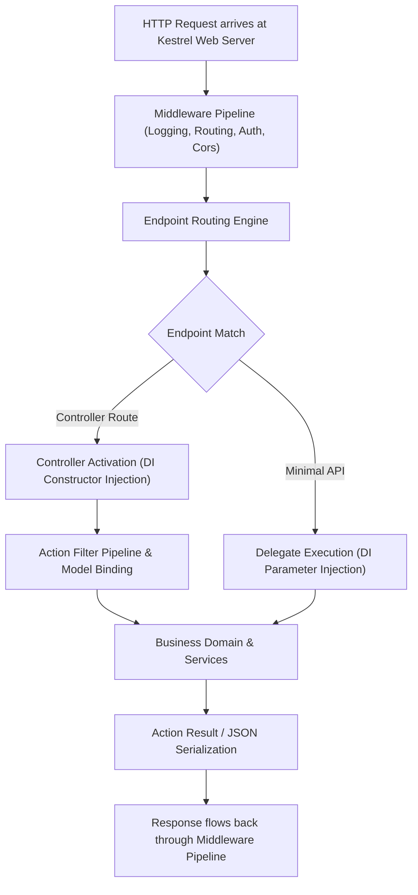
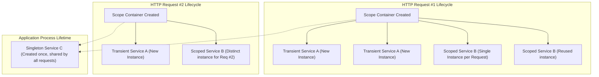

<!-- docs/module-02-aspnet-core-webapi/01-architecture-di-pipeline.md -->
# 2.1 ASP.NET Core Web API Architecture & Dependency Injection

## Learning Objectives
- Understand the modern ASP.NET Core Web API architecture and `Program.cs` unification.
- Deep dive into Dependency Injection (DI) service lifetimes: `Transient`, `Scoped`, and `Singleton`.
- Master the service container, avoid captive dependencies, and prevent memory leaks.
- Trace the complete HTTP Request/Response pipeline lifecycle.

---

## 1. Web API Anatomy & Modern Program.cs

Starting in .NET 6/7/8+, `Program.cs` consolidates the legacy `Startup.cs` into a streamlined top-level statement model using `WebApplicationBuilder` and `WebApplication`.



---

## 2. Dependency Injection Service Lifetimes

The .NET built-in IoC (Inversion of Control) container manages three primary service lifetimes:



### Lifetime Specifications

| Lifetime | Method Registration | Instantiation Frequency | Best Used For |
| :--- | :--- | :--- | :--- |
| **Transient** | `builder.Services.AddTransient<T, U>()` | Every single time requested | Lightweight, stateless utility services |
| **Scoped** | `builder.Services.AddScoped<T, U>()` | Exactly once per HTTP request scope | Database Contexts (`DbContext`), Repositories, Unit of Work |
| **Singleton** | `builder.Services.AddSingleton<T, U>()` | Exactly once for the lifetime of the application | In-memory caches, configuration wrappers, stateful background services |

> [!CAUTION]
> **Captive Dependencies Bug**: Never inject a `Scoped` service (such as `DbContext`) into a `Singleton` service! If a Singleton holds a reference to a Scoped service, that Scoped service will stay alive forever in memory, preventing garbage collection and causing concurrency collisions and stale DB tracking.

---

## 3. Complete Code Example: Verifying DI Lifetimes

Below is a self-contained, executable minimal API demonstration that proves and outputs DI lifetime behavior:

```csharp
// Program.cs
using System.Text.Json;

var builder = WebApplication.CreateBuilder(args);

// Register interfaces with distinct lifetimes
builder.Services.AddTransient<ITransientService, OperationGuidService>();
builder.Services.AddScoped<IScopedService, OperationGuidService>();
builder.Services.AddSingleton<ISingletonService, OperationGuidService>();
builder.Services.AddScoped<LifetimeInspectorService>();

var app = builder.Build();

app.MapGet("/api/diagnostics/lifetimes", (
    ITransientService transient1,
    ITransientService transient2,
    IScopedService scoped1,
    IScopedService scoped2,
    ISingletonService singleton1,
    LifetimeInspectorService inspector) =>
{
    var report = new
    {
        DirectInjections = new
        {
            Transient1 = transient1.OperationId,
            Transient2 = transient2.OperationId,
            TransientEqual = transient1.OperationId == transient2.OperationId, // False
            Scoped1 = scoped1.OperationId,
            Scoped2 = scoped2.OperationId,
            ScopedEqual = scoped1.OperationId == scoped2.OperationId, // True
            Singleton = singleton1.OperationId
        },
        InspectorInjections = new
        {
            InspectorScoped = inspector.ScopedService.OperationId,
            MatchesDirectScoped = inspector.ScopedService.OperationId == scoped1.OperationId, // True
            InspectorTransient = inspector.TransientService.OperationId,
            InspectorSingleton = inspector.SingletonService.OperationId,
            MatchesDirectSingleton = inspector.SingletonService.OperationId == singleton1.OperationId // True
        }
    };

    return Results.Ok(report);
});

app.Run();

// ---------------- Supporting Interfaces & Implementations ----------------

public interface IOperationService
{
    Guid OperationId { get; }
}

public interface ITransientService : IOperationService { }
public interface IScopedService : IOperationService { }
public interface ISingletonService : IOperationService { }

public sealed class OperationGuidService : ITransientService, IScopedService, ISingletonService
{
    public Guid OperationId { get; } = Guid.NewGuid();
}

public sealed class LifetimeInspectorService
{
    public ITransientService TransientService { get; }
    public IScopedService ScopedService { get; }
    public ISingletonService SingletonService { get; }

    public LifetimeInspectorService(
        ITransientService transientService,
        IScopedService scopedService,
        ISingletonService singletonService)
    {
        TransientService = transientService;
        ScopedService = scopedService;
        SingletonService = singletonService;
    }
}
```

---

## 4. Key Takeaways
1. Modern .NET consolidates initialization into `WebApplication.CreateBuilder(args)`.
2. Keep database connections and EF Core contexts strictly `Scoped`.
3. Detect captive dependencies early in development by enabling container validation:
   ```csharp
   builder.Host.UseDefaultServiceProvider((context, options) =>
   {
       options.ValidateScopes = context.HostingEnvironment.IsDevelopment();
       options.ValidateOnBuild = true;
   });
   ```
