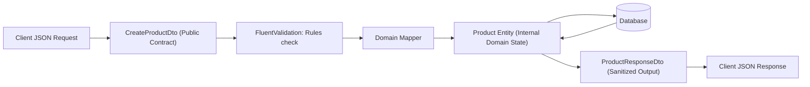

<!-- docs/module-02-aspnet-core-webapi/02-routing-controllers-minimal-apis.md -->
# 2.2 Routing, Controllers, Minimal APIs & Model Validation

## Learning Objectives
- Master RESTful attribute routing and Route Constraints in ASP.NET Core.
- Evaluate structural and performance trade-offs between Controllers and Minimal APIs.
- Enforce domain encapsulation using the Data Transfer Object (DTO) pattern.
- Integrate `FluentValidation` to write strongly-typed, testable validation rules with automatic error formatting.

---

## 1. Controller-Based vs. Minimal APIs

ASP.NET Core provides two complementary approaches for exposing HTTP endpoints:

| Feature | Controller-Based APIs (`[ApiController]`) | Minimal APIs (`app.MapGet / MapPost`) |
| :--- | :--- | :--- |
| **Organization** | Class-based grouping (`ProductsController.cs`) | Functional endpoint routing with extension methods |
| **Startup Overhead** | Uses reflection to discover controllers and actions | Direct lambda compilation; lower memory and faster cold starts |
| **Filters & Pipeline** | Action Filters, Resource Filters, Result Filters | Endpoint Filters (`AddEndpointFilter`) |
| **Ideal Use Case** | Large enterprise systems with complex shared controller logic | Microservices, high-throughput cloud endpoints, serverless |

---

## 2. The DTO Pattern & Over-Posting Prevention



> [!WARNING]
> **Over-Posting Vulnerability**: Never bind database entities directly to API parameters. A malicious client could send `"isAdmin": true` or `"internalCost": 0.01` in the payload. DTOs isolate incoming and outgoing data contracts.

---

## 3. Complete Code Implementation: Products API with FluentValidation

Below is a complete, working Minimal API implementation showcasing route constraints, DTO mapping, FluentValidation, and endpoint filters.

### 1. DTOs and Domain Models

```csharp
namespace Module02.WebApi.Models;

public sealed class Product
{
    public Guid Id { get; set; }
    public string Sku { get; set; } = string.Empty;
    public string Name { get; set; } = string.Empty;
    public string Description { get; set; } = string.Empty;
    public decimal Price { get; set; }
    public int StockQuantity { get; set; }
    public decimal InternalCost { get; set; } // Sensitive: never exposed in DTO
    public DateTime CreatedAtUtc { get; set; }
}

public sealed record CreateProductRequest(
    string Sku,
    string Name,
    string Description,
    decimal Price,
    int InitialStock);

public sealed record UpdateProductRequest(
    string Name,
    string Description,
    decimal Price,
    int StockQuantity);

public sealed record ProductResponse(
    Guid Id,
    string Sku,
    string Name,
    string Description,
    decimal Price,
    int StockQuantity,
    bool InStock);
```

### 2. FluentValidation Rules

```csharp
namespace Module02.WebApi.Validation;

using FluentValidation;
using Module02.WebApi.Models;

public sealed class CreateProductRequestValidator : AbstractValidator<CreateProductRequest>
{
    public CreateProductRequestValidator()
    {
        RuleFor(x => x.Sku)
            .NotEmpty().WithMessage("SKU is required.")
            .Matches(@"^[A-Z0-9]{3}-[A-Z0-9]{4}$")
            .WithMessage("SKU must match format 'XXX-XXXX' (uppercase alphanumeric).");

        RuleFor(x => x.Name)
            .NotEmpty().WithMessage("Product name is required.")
            .Length(3, 120).WithMessage("Product name must be between 3 and 120 characters.");

        RuleFor(x => x.Price)
            .GreaterThan(0m).WithMessage("Price must be strictly positive.");

        RuleFor(x => x.InitialStock)
            .GreaterThanOrEqualTo(0).WithMessage("Initial stock cannot be negative.");
    }
}
```

### 3. Program.cs with Minimal API Endpoints & Generic Validation Filter

```csharp
// Program.cs
using System.Collections.Concurrent;
using FluentValidation;
using Module02.WebApi.Models;
using Module02.WebApi.Validation;

var builder = WebApplication.CreateBuilder(args);

// Register FluentValidation validators from assembly
builder.Services.AddValidatorsFromAssemblyContaining<CreateProductRequestValidator>();

var app = builder.Build();

// In-memory data store for demonstration
var productsDb = new ConcurrentDictionary<Guid, Product>();

// Route Group with route constraints and prefixes
var productsGroup = app.MapGroup("/api/products");

// 1. GET all products
productsGroup.MapGet("/", () =>
{
    var dtos = productsDb.Values.Select(p => new ProductResponse(
        p.Id, p.Sku, p.Name, p.Description, p.Price, p.StockQuantity, p.StockQuantity > 0));
    return Results.Ok(dtos);
});

// 2. GET product by GUID route constraint
productsGroup.MapGet("/{id:guid}", (Guid id) =>
{
    if (productsDb.TryGetValue(id, out var p))
    {
        return Results.Ok(new ProductResponse(
            p.Id, p.Sku, p.Name, p.Description, p.Price, p.StockQuantity, p.StockQuantity > 0));
    }
    return Results.NotFound(new { Message = $"Product with ID '{id}' was not found." });
});

// 3. POST create product with FluentValidation
productsGroup.MapPost("/", async (
    CreateProductRequest request, 
    IValidator<CreateProductRequest> validator) =>
{
    var validationResult = await validator.ValidateAsync(request);
    if (!validationResult.IsValid)
    {
        return Results.ValidationProblem(validationResult.ToDictionary());
    }

    var entity = new Product
    {
        Id = Guid.NewGuid(),
        Sku = request.Sku.ToUpperInvariant(),
        Name = request.Name,
        Description = request.Description,
        Price = request.Price,
        StockQuantity = request.InitialStock,
        InternalCost = request.Price * 0.6m,
        CreatedAtUtc = DateTime.UtcNow
    };

    productsDb[entity.Id] = entity;

    var responseDto = new ProductResponse(
        entity.Id, entity.Sku, entity.Name, entity.Description, entity.Price, entity.StockQuantity, entity.StockQuantity > 0);

    return Results.Created($"/api/products/{entity.Id}", responseDto);
});

// 4. DELETE product
productsGroup.MapDelete("/{id:guid}", (Guid id) =>
{
    if (productsDb.TryRemove(id, out _))
    {
        return Results.NoContent();
    }
    return Results.NotFound(new { Message = $"Product with ID '{id}' was not found." });
});

app.Run();
```

---

## 4. Key Takeaways
1. Always validate external input using **FluentValidation** before invoking domain or persistence logic.
2. Route constraints (e.g. `{id:guid}`) prevent unnecessary controller execution when given invalid route parameters.
3. Return standard HTTP status codes: `200 OK`, `201 Created` with a `Location` header, `204 NoContent`, `400 BadRequest` (or `422 Unprocessable Entity`), and `404 NotFound`.
