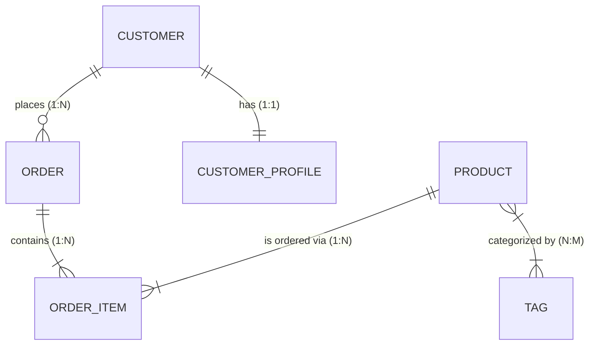

<!-- docs/module-02-aspnet-core-webapi/03-ef-core-repository-unit-of-work.md -->
# 2.3 Entity Framework Core, Relationships & Repository Pattern

## Learning Objectives
- Architect EF Core Code-First data models with clean entity configurations using Fluent API.
- Map complex database relationships: One-to-One (1:1), One-to-Many (1:N), and Many-to-Many (N:M).
- Execute database migrations, seeding, and schema version management.
- Implement the Repository and Unit of Work patterns to decouple data access from business controllers.

---

## 1. Entity Relationships Overview



---

## 2. Complete EF Core Models & Fluent API Configuration

```csharp
namespace Module02.Data.Entities;

public sealed class Customer
{
    public Guid Id { get; set; }
    public string Email { get; set; } = string.Empty;
    public string FullName { get; set; } = string.Empty;
    public CustomerProfile? Profile { get; set; } // 1:1 Navigation
    public ICollection<Order> Orders { get; set; } = new List<Order>(); // 1:N Navigation
}

public sealed class CustomerProfile
{
    public Guid Id { get; set; }
    public Guid CustomerId { get; set; }
    public Customer Customer { get; set; } = null!;
    public string PhoneNumber { get; set; } = string.Empty;
    public string ShippingAddress { get; set; } = string.Empty;
}

public sealed class Order
{
    public Guid Id { get; set; }
    public Guid CustomerId { get; set; }
    public Customer Customer { get; set; } = null!;
    public DateTime PlacedAtUtc { get; set; }
    public decimal TotalAmount { get; set; }
    public ICollection<OrderItem> Items { get; set; } = new List<OrderItem>();
}

public sealed class OrderItem
{
    public Guid Id { get; set; }
    public Guid OrderId { get; set; }
    public Order Order { get; set; } = null!;
    public Guid ProductId { get; set; }
    public Product Product { get; set; } = null!;
    public int Quantity { get; set; }
    public decimal UnitPrice { get; set; }
}

public sealed class Product
{
    public Guid Id { get; set; }
    public string Name { get; set; } = string.Empty;
    public decimal Price { get; set; }
    public ICollection<Tag> Tags { get; set; } = new List<Tag>(); // N:M Navigation
}

public sealed class Tag
{
    public Guid Id { get; set; }
    public string Label { get; set; } = string.Empty;
    public ICollection<Product> Products { get; set; } = new List<Product>(); // N:M Navigation
}
```

### DbContext Configuration with Fluent API

```csharp
namespace Module02.Data;

using Microsoft.EntityFrameworkCore;
using Module02.Data.Entities;

public sealed class AppDbContext : DbContext
{
    public DbSet<Customer> Customers => Set<Customer>();
    public DbSet<CustomerProfile> Profiles => Set<CustomerProfile>();
    public DbSet<Order> Orders => Set<Order>();
    public DbSet<OrderItem> OrderItems => Set<OrderItem>();
    public DbSet<Product> Products => Set<Product>();
    public DbSet<Tag> Tags => Set<Tag>();

    public AppDbContext(DbContextOptions<AppDbContext> options) : base(options) { }

    protected override void OnModelCreating(ModelBuilder modelBuilder)
    {
        base.OnModelCreating(modelBuilder);

        // 1. Customer Configuration
        modelBuilder.Entity<Customer>(entity =>
        {
            entity.HasKey(c => c.Id);
            entity.HasIndex(c => c.Email).IsUnique();
            entity.Property(c => c.Email).IsRequired().HasMaxLength(180);
            entity.Property(c => c.FullName).IsRequired().HasMaxLength(100);

            // 1:1 with CustomerProfile
            entity.HasOne(c => c.Profile)
                  .WithOne(p => p.Customer)
                  .HasForeignKey<CustomerProfile>(p => p.CustomerId)
                  .OnDelete(DeleteBehavior.Cascade);
        });

        // 2. Order Configuration (1:N with Customer and OrderItems)
        modelBuilder.Entity<Order>(entity =>
        {
            entity.HasKey(o => o.Id);
            entity.Property(o => o.TotalAmount).HasPrecision(18, 2);

            entity.HasOne(o => o.Customer)
                  .WithMany(c => c.Orders)
                  .HasForeignKey(o => o.CustomerId)
                  .OnDelete(DeleteBehavior.Restrict);
        });

        // 3. OrderItem Configuration
        modelBuilder.Entity<OrderItem>(entity =>
        {
            entity.HasKey(oi => oi.Id);
            entity.Property(oi => oi.UnitPrice).HasPrecision(18, 2);

            entity.HasOne(oi => oi.Order)
                  .WithMany(o => o.Items)
                  .HasForeignKey(oi => oi.OrderId)
                  .OnDelete(DeleteBehavior.Cascade);

            entity.HasOne(oi => oi.Product)
                  .WithMany()
                  .HasForeignKey(oi => oi.ProductId)
                  .OnDelete(DeleteBehavior.Restrict);
        });

        // 4. Product & Tag Many-to-Many (N:M)
        modelBuilder.Entity<Product>(entity =>
        {
            entity.HasKey(p => p.Id);
            entity.Property(p => p.Name).IsRequired().HasMaxLength(150);
            entity.Property(p => p.Price).HasPrecision(18, 2);

            entity.HasMany(p => p.Tags)
                  .WithMany(t => t.Products)
                  .UsingEntity(j => j.ToTable("ProductTags"));
        });
    }
}
```

---

## 3. The Repository and Unit of Work Pattern

```csharp
namespace Module02.Data.Repositories;

using System.Linq.Expressions;
using Microsoft.EntityFrameworkCore;
using Module02.Data;

public interface IRepository<T> where T : class
{
    Task<T?> GetByIdAsync(Guid id, CancellationToken ct = default);
    Task<IReadOnlyList<T>> ListAsync(Expression<Func<T, bool>>? predicate = null, CancellationToken ct = default);
    Task AddAsync(T entity, CancellationToken ct = default);
    void Update(T entity);
    void Remove(T entity);
}

public class GenericRepository<T> : IRepository<T> where T : class
{
    protected readonly AppDbContext Context;
    protected readonly DbSet<T> DbSet;

    public GenericRepository(AppDbContext context)
    {
        Context = context;
        DbSet = context.Set<T>();
    }

    public virtual async Task<T?> GetByIdAsync(Guid id, CancellationToken ct = default)
    {
        return await DbSet.FindAsync(new object[] { id }, ct);
    }

    public virtual async Task<IReadOnlyList<T>> ListAsync(Expression<Func<T, bool>>? predicate = null, CancellationToken ct = default)
    {
        IQueryable<T> query = DbSet.AsNoTracking();
        if (predicate is not null)
        {
            query = query.Where(predicate);
        }
        return await query.ToListAsync(ct);
    }

    public virtual async Task AddAsync(T entity, CancellationToken ct = default)
    {
        await DbSet.AddAsync(entity, ct);
    }

    public virtual void Update(T entity)
    {
        DbSet.Update(entity);
    }

    public virtual void Remove(T entity)
    {
        DbSet.Remove(entity);
    }
}

public interface IUnitOfWork : IDisposable
{
    IRepository<Entities.Customer> Customers { get; }
    IRepository<Entities.Order> Orders { get; }
    IRepository<Entities.Product> Products { get; }
    Task<int> CommitAsync(CancellationToken ct = default);
}

public sealed class UnitOfWork : IUnitOfWork
{
    private readonly AppDbContext _context;

    public IRepository<Entities.Customer> Customers { get; }
    public IRepository<Entities.Order> Orders { get; }
    public IRepository<Entities.Product> Products { get; }

    public UnitOfWork(AppDbContext context)
    {
        _context = context;
        Customers = new GenericRepository<Entities.Customer>(_context);
        Orders = new GenericRepository<Entities.Order>(_context);
        Products = new GenericRepository<Entities.Product>(_context);
    }

    public async Task<int> CommitAsync(CancellationToken ct = default)
    {
        return await _context.SaveChangesAsync(ct);
    }

    public void Dispose()
    {
        _context.Dispose();
    }
}
```

---

## 4. Key Takeaways
1. Explicitly configure navigation properties using **Fluent API** rather than attributes to keep domain models clean and database-agnostic.
2. Use `.AsNoTracking()` on read queries to bypass EF Core change tracking and maximize query throughput.
3. The **Unit of Work** guarantees that modifications across multiple repositories execute inside a unified atomic database transaction when calling `SaveChangesAsync()`.
