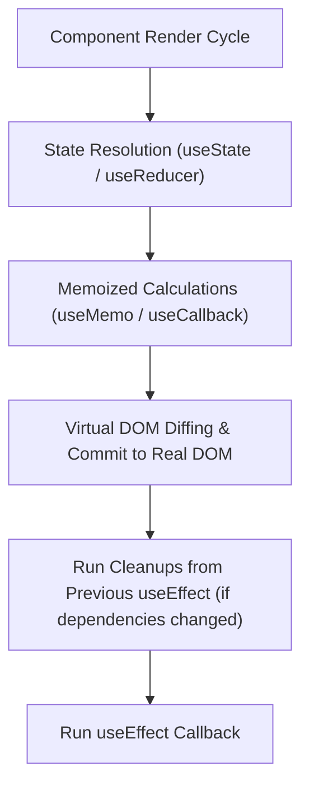

<!-- docs/module-03-modern-react-typescript/02-deep-dive-react-hooks.md -->
# 3.2 Deep Dive into React Hooks

## Learning Objectives
- Master the full React Hooks suite: `useState`, `useEffect`, `useContext`, `useReducer`, `useMemo`, and `useCallback`.
- Implement robust cleanup and race-condition prevention in `useEffect` using `AbortController`.
- Structure complex component state using `useReducer` with TypeScript Discriminated Unions.
- Author modular, reusable custom hooks following React's Rules of Hooks.

---

## 1. The React Hooks Mental Model



---

## 2. Preventing Async Race Conditions with useEffect & AbortController

A frequent production bug occurs when rapid state changes trigger multiple concurrent asynchronous requests, and an older request resolves *after* a newer request, overwriting valid data.

```tsx
// src/hooks/useFetchWithAbort.ts
import { useState, useEffect } from 'react';

export interface FetchState<T> {
  data: T | null;
  isLoading: boolean;
  error: Error | null;
}

export function useFetchWithAbort<T>(url: string): FetchState<T> {
  const [state, setState] = useState<FetchState<T>>({
    data: null,
    isLoading: true,
    error: null,
  });

  useEffect(() => {
    const abortController = new AbortController();
    setState({ data: null, isLoading: true, error: null });

    async function executeFetch() {
      try {
        const response = await fetch(url, { signal: abortController.signal });
        if (!response.ok) {
          throw new Error(`HTTP ${response.status}: ${response.statusText}`);
        }
        const json = (await response.json()) as T;
        setState({ data: json, isLoading: false, error: null });
      } catch (err: unknown) {
        if (err instanceof DOMException && err.name === 'AbortError') {
          // Request was intentionally cancelled: do not mutate state
          return;
        }
        setState({
          data: null,
          isLoading: false,
          error: err instanceof Error ? err : new Error(String(err)),
        });
      }
    }

    executeFetch();

    // Cleanup: Invoked immediately if url changes or component unmounts
    return () => {
      abortController.abort();
    };
  }, [url]);

  return state;
}
```

---

## 3. Complex State Management: useReducer with Discriminated Unions

When component state involves multiple interrelated fields, `useReducer` guarantees predictable, atomic state transitions:

```tsx
// src/components/DataPaginationReducer.tsx
import React, { useReducer } from 'react';

interface PaginationState<T> {
  items: T[];
  currentPage: number;
  pageSize: number;
  totalItems: number;
  isLoading: boolean;
  errorMessage: string | null;
}

// Discriminated union of actions
type PaginationAction<T> =
  | { type: 'FETCH_START' }
  | { type: 'FETCH_SUCCESS'; payload: { items: T[]; totalItems: number } }
  | { type: 'FETCH_FAILURE'; payload: string }
  | { type: 'SET_PAGE'; payload: number }
  | { type: 'SET_PAGE_SIZE'; payload: number };

function paginationReducer<T>(
  state: PaginationState<T>,
  action: PaginationAction<T>
): PaginationState<T> {
  switch (action.type) {
    case 'FETCH_START':
      return { ...state, isLoading: true, errorMessage: null };
    case 'FETCH_SUCCESS':
      return {
        ...state,
        isLoading: false,
        items: action.payload.items,
        totalItems: action.payload.totalItems,
      };
    case 'FETCH_FAILURE':
      return { ...state, isLoading: false, errorMessage: action.payload };
    case 'SET_PAGE':
      return { ...state, currentPage: action.payload };
    case 'SET_PAGE_SIZE':
      return { ...state, pageSize: action.payload, currentPage: 1 };
    default:
      return state;
  }
}
```

---

## 4. Referential Equality: useMemo and useCallback

React re-creates functions and recalculates inline expressions on every single render. When passing callbacks down to heavily optimized child components (`React.memo`), use `useCallback` to preserve function identity:

```tsx
// src/components/SearchFilterPanel.tsx
import React, { useState, useMemo, useCallback } from 'react';

interface MetricItem {
  id: string;
  name: string;
  value: number;
  category: 'CPU' | 'Memory' | 'Network';
}

export function SearchFilterPanel({ metrics }: { metrics: MetricItem[] }) {
  const [query, setQuery] = useState('');
  const [selectedCategory, setSelectedCategory] = useState<string>('ALL');

  // Expensive filtering memoized across renders
  const filteredMetrics = useMemo(() => {
    return metrics.filter((m) => {
      const matchesQuery = m.name.toLowerCase().includes(query.toLowerCase());
      const matchesCategory = selectedCategory === 'ALL' || m.category === selectedCategory;
      return matchesQuery && matchesCategory;
    });
  }, [metrics, query, selectedCategory]);

  // Stable callback reference passed to child inputs
  const handleReset = useCallback(() => {
    setQuery('');
    setSelectedCategory('ALL');
  }, []);

  return (
    <div className="p-4 bg-slate-50 border rounded-lg space-y-4">
      <div className="flex gap-4">
        <input
          type="text"
          value={query}
          onChange={(e) => setQuery(e.target.value)}
          placeholder="Filter by metric name..."
          className="px-3 py-1.5 border rounded-md w-64 text-sm"
        />
        <select
          value={selectedCategory}
          onChange={(e) => setSelectedCategory(e.target.value)}
          className="px-3 py-1.5 border rounded-md text-sm"
        >
          <option value="ALL">All Categories</option>
          <option value="CPU">CPU</option>
          <option value="Memory">Memory</option>
          <option value="Network">Network</option>
        </select>
        <button
          type="button"
          onClick={handleReset}
          className="px-3 py-1.5 bg-slate-200 hover:bg-slate-300 rounded text-xs font-semibold"
        >
          Reset Filters
        </button>
      </div>

      <div className="text-xs text-slate-500">
        Showing {filteredMetrics.length} of {metrics.length} metrics
      </div>
    </div>
  );
}
```

---

## 5. Reusable Custom Hook: useDebounce

Debouncing prevents high-frequency network hammering when users type into auto-search inputs:

```tsx
// src/hooks/useDebounce.ts
import { useState, useEffect } from 'react';

export function useDebounce<T>(value: T, delayMs: number = 300): T {
  const [debouncedValue, setDebouncedValue] = useState<T>(value);

  useEffect(() => {
    const handler = setTimeout(() => {
      setDebouncedValue(value);
    }, delayMs);

    return () => {
      clearTimeout(handler);
    };
  }, [value, delayMs]);

  return debouncedValue;
}
```

---

## 6. Key Takeaways
1. Always clean up subscriptions, timers, and active network calls in `useEffect` cleanups.
2. Use **TypeScript Discriminated Unions** in `useReducer` to eliminate impossible states.
3. Apply `useMemo` and `useCallback` deliberately for computationally intensive tasks or referential stability in memoized children.
