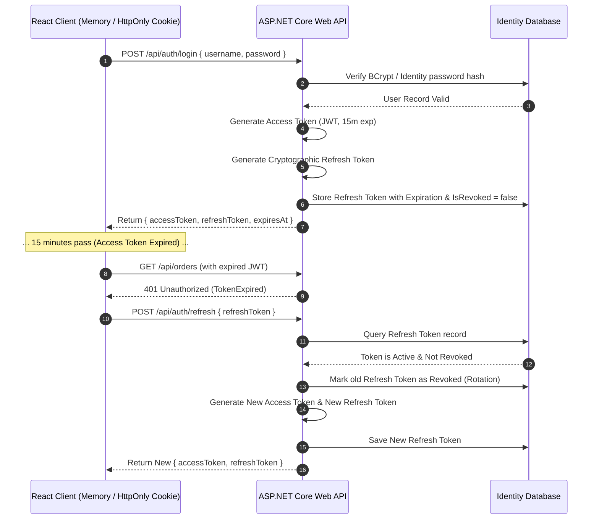

<!-- docs/module-04-advanced-aspnet-core/01-jwt-auth-roles-claims-identity.md -->
# 4.1 JWT Authentication, Claims-Based Authorization & Refresh Tokens

## Learning Objectives
- Architect a stateless JWT authentication subsystem with cryptographic symmetric/asymmetric signature verification.
- Implement short-lived Access Tokens paired with rotating, revocable Refresh Tokens stored in the database.
- Enforce granular access control via Claims-Based Authorization Policies and Role-Based Access Control (RBAC).
- Secure ASP.NET Core endpoints using `[Authorize(Policy = "...")]` and custom policy authorization requirements.

---

## 1. The Token Exchange & Refresh Workflow

Access tokens are short-lived (e.g. 15 minutes) to limit exposure if leaked. When an access token expires, the client uses a long-lived, securely stored refresh token (e.g. 7 days) to obtain a new token pair without requiring user re-authentication.



---

## 2. Complete Token Service Implementation

```csharp
namespace Module04.Security.Services;

using System.IdentityModel.Tokens.Jwt;
using System.Security.Claims;
using System.Security.Cryptography;
using System.Text;
using Microsoft.IdentityModel.Tokens;

public sealed record TokenResponse(
    string AccessToken, 
    string RefreshToken, 
    DateTime AccessTokenExpiresAtUtc);

public sealed class ApplicationUser
{
    public Guid Id { get; set; }
    public string Username { get; set; } = string.Empty;
    public string Email { get; set; } = string.Empty;
    public string Role { get; set; } = "User"; // e.g. "Admin", "Manager", "User"
    public List<RefreshToken> RefreshTokens { get; set; } = new();
}

public sealed class RefreshToken
{
    public Guid Id { get; set; }
    public string Token { get; set; } = string.Empty;
    public DateTime ExpiresAtUtc { get; set; }
    public bool IsRevoked { get; set; }
    public DateTime CreatedAtUtc { get; set; }
    public Guid UserId { get; set; }

    public bool IsActive => !IsRevoked && DateTime.UtcNow < ExpiresAtUtc;
}

public interface ITokenService
{
    TokenResponse GenerateTokens(ApplicationUser user);
    ClaimsPrincipal? ValidateExpiredAccessToken(string token);
}

public sealed class JwtTokenService : ITokenService
{
    private readonly string _secretKey;
    private readonly string _issuer;
    private readonly string _audience;
    private readonly TimeSpan _accessTokenLifetime = TimeSpan.FromMinutes(15);
    private readonly TimeSpan _refreshTokenLifetime = TimeSpan.FromDays(7);

    public JwtTokenService(IConfiguration config)
    {
        _secretKey = config["Jwt:Key"] ?? "SUPER_SECRET_PRODUCTION_KEY_THAT_IS_AT_LEAST_32_BYTES_LONG!";
        _issuer = config["Jwt:Issuer"] ?? "https://api.fullstackenterprise.com";
        _audience = config["Jwt:Audience"] ?? "https://fullstackenterprise.com";
    }

    public TokenResponse GenerateTokens(ApplicationUser user)
    {
        var securityKey = new SymmetricSecurityKey(Encoding.UTF8.GetBytes(_secretKey));
        var credentials = new SigningCredentials(securityKey, SecurityAlgorithms.HmacSha256);

        var claims = new List<Claim>
        {
            new(JwtRegisteredClaimNames.Sub, user.Id.ToString()),
            new(JwtRegisteredClaimNames.Email, user.Email),
            new(JwtRegisteredClaimNames.UniqueName, user.Username),
            new(ClaimTypes.Role, user.Role),
            new("permission", user.Role == "Admin" ? "catalog:manage" : "catalog:read"),
            new(JwtRegisteredClaimNames.Jti, Guid.NewGuid().ToString())
        };

        var expires = DateTime.UtcNow.Add(_accessTokenLifetime);

        var tokenDescriptor = new SecurityTokenDescriptor
        {
            Subject = new ClaimsIdentity(claims),
            Expires = expires,
            Issuer = _issuer,
            Audience = _audience,
            SigningCredentials = credentials
        };

        var handler = new JwtSecurityTokenHandler();
        var securityToken = handler.CreateToken(tokenDescriptor);
        var accessToken = handler.WriteToken(securityToken);

        // Generate high-entropy cryptographic refresh token
        byte[] randomBytes = new byte[64];
        using var rng = RandomNumberGenerator.Create();
        rng.GetBytes(randomBytes);
        var rawRefreshToken = Convert.ToBase64String(randomBytes);

        var refreshTokenEntity = new RefreshToken
        {
            Id = Guid.NewGuid(),
            Token = rawRefreshToken,
            UserId = user.Id,
            CreatedAtUtc = DateTime.UtcNow,
            ExpiresAtUtc = DateTime.UtcNow.Add(_refreshTokenLifetime),
            IsRevoked = false
        };

        user.RefreshTokens.Add(refreshTokenEntity);

        return new TokenResponse(accessToken, rawRefreshToken, expires);
    }

    public ClaimsPrincipal? ValidateExpiredAccessToken(string token)
    {
        var tokenValidationParameters = new TokenValidationParameters
        {
            ValidateAudience = true,
            ValidAudience = _audience,
            ValidateIssuer = true,
            ValidIssuer = _issuer,
            ValidateIssuerSigningKey = true,
            IssuerSigningKey = new SymmetricSecurityKey(Encoding.UTF8.GetBytes(_secretKey)),
            ValidateLifetime = false // Critical: Allow expired access token so we can extract claims for refresh!
        };

        var tokenHandler = new JwtSecurityTokenHandler();
        var principal = tokenHandler.ValidateToken(token, tokenValidationParameters, out var securityToken);

        if (securityToken is not JwtSecurityToken jwtSecurityToken ||
            !jwtSecurityToken.Header.Alg.Equals(SecurityAlgorithms.HmacSha256, StringComparison.InvariantCultureIgnoreCase))
        {
            throw new SecurityTokenException("Invalid JWT signature algorithm");
        }

        return principal;
    }
}
```

---

## 3. Policy & Claims-Based Authorization in Program.cs

```csharp
// Program.cs
using System.Text;
using Microsoft.AspNetCore.Authentication.JwtBearer;
using Microsoft.IdentityModel.Tokens;
using Module04.Security.Services;

var builder = WebApplication.CreateBuilder(args);

var jwtKey = builder.Configuration["Jwt:Key"] ?? "SUPER_SECRET_PRODUCTION_KEY_THAT_IS_AT_LEAST_32_BYTES_LONG!";
var issuer = builder.Configuration["Jwt:Issuer"] ?? "https://api.fullstackenterprise.com";
var audience = builder.Configuration["Jwt:Audience"] ?? "https://fullstackenterprise.com";

// Register Token Service
builder.Services.AddSingleton<ITokenService, JwtTokenService>();

// Configure Authentication Middleware
builder.Services.AddAuthentication(JwtBearerDefaults.AuthenticationScheme)
    .AddJwtBearer(options =>
    {
        options.TokenValidationParameters = new TokenValidationParameters
        {
            ValidateIssuer = true,
            ValidIssuer = issuer,
            ValidateAudience = true,
            ValidAudience = audience,
            ValidateLifetime = true,
            ClockSkew = TimeSpan.Zero, // Eliminate the default 5-minute clock drift allowance
            ValidateIssuerSigningKey = true,
            IssuerSigningKey = new SymmetricSecurityKey(Encoding.UTF8.GetBytes(jwtKey))
        };
    });

// Configure Custom Claims Policies
builder.Services.AddAuthorization(options =>
{
    options.AddPolicy("RequireAdminRole", policy => 
        policy.RequireRole("Admin"));

    options.AddPolicy("CanManageCatalog", policy => 
        policy.RequireClaim("permission", "catalog:manage"));
});

var app = builder.Build();

app.UseAuthentication();
app.UseAuthorization();

// ---------------- Protected Endpoints ----------------

// Public Endpoint
app.MapGet("/api/public/ping", () => Results.Ok(new { message = "Public access" }));

// Standard Authenticated User Endpoint
app.MapGet("/api/profile", (ClaimsPrincipal user) =>
{
    var username = user.Identity?.Name;
    var email = user.FindFirst(ClaimTypes.Email)?.Value;
    return Results.Ok(new { username, email });
}).RequireAuthorization();

// High Privilege Policy Endpoint
app.MapDelete("/api/catalog/{id:guid}", (Guid id) =>
{
    return Results.Ok(new { message = $"Catalog item {id} deleted successfully." });
}).RequireAuthorization("CanManageCatalog");

app.Run();
```

---

## 4. Key Takeaways
1. Set `ClockSkew = TimeSpan.Zero` on JWT validation to enforce exact expiration times without CLR drift buffers.
2. Store refresh tokens in the database with `IsRevoked` flags to enable immediate session revocation and token rotation.
3. Decouple authorization logic from business handlers using **Policy-based requirements**.
