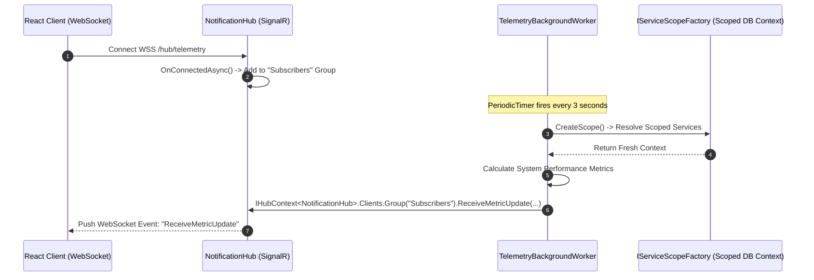

<!-- docs/module-04-advanced-aspnet-core/04-signalr-and-background-workers.md -->
# 4.4 Real-Time WebSockets with SignalR & Background Services

## Learning Objectives
- Architect real-time, bi-directional communication channels using **SignalR Hubs**.
- Implement strongly-typed SignalR Hubs (`Hub<IClientContract>`) to eliminate magic strings.
- Manage real-time rooms and targeted broadcasting using SignalR **Groups**.
- Execute scheduled recurring workloads using `BackgroundService` and `PeriodicTimer`.
- Resolve scoped dependencies (like `DbContext`) safely inside long-running singleton background workers using `IServiceScopeFactory`.

---

## 1. Real-Time SignalR & Worker Topology



---

## 2. Strongly-Typed Hub & Contract Design

Strongly-typed Hubs prevent runtime typos by binding client-side event invocations to a C# interface:

```csharp
namespace Module04.RealTime.Hubs;

using Microsoft.AspNetCore.SignalR;

public sealed record SystemMetricPayload(
    string MachineName, 
    double CpuUsagePercent, 
    long MemoryUsageMegabytes, 
    DateTime TimestampUtc);

// Strongly typed contract representing methods callable on the client
public interface ITelemetryClient
{
    Task ReceiveMetricUpdate(SystemMetricPayload payload);
    Task ReceiveAlert(string severity, string message);
}

public sealed class TelemetryHub : Hub<ITelemetryClient>
{
    private readonly ILogger<TelemetryHub> _logger;

    public TelemetryHub(ILogger<TelemetryHub> logger)
    {
        _logger = logger;
    }

    public override async Task OnConnectedAsync()
    {
        _logger.LogInformation("Client connected: {ConnectionId}", Context.ConnectionId);
        // Automatically join the public metrics stream
        await Groups.AddToGroupAsync(Context.ConnectionId, "LiveTelemetryGroup");
        await base.OnConnectedAsync();
    }

    public override async Task OnDisconnectedAsync(Exception? exception)
    {
        _logger.LogInformation("Client disconnected: {ConnectionId}", Context.ConnectionId);
        await Groups.RemoveFromGroupAsync(Context.ConnectionId, "LiveTelemetryGroup");
        await base.OnDisconnectedAsync(exception);
    }

    // Client can invoke this to subscribe to custom topic rooms
    public async Task JoinChannel(string channelName)
    {
        await Groups.AddToGroupAsync(Context.ConnectionId, channelName);
    }
}
```

---

## 3. BackgroundService with PeriodicTimer & Scoped Service Resolution

A `BackgroundService` is registered as a Singleton. To interact with Scoped database contexts or repositories, you must create an explicit scope:

```csharp
namespace Module04.RealTime.Workers;

using System.Diagnostics;
using Microsoft.AspNetCore.SignalR;
using Module04.RealTime.Hubs;

public sealed class TelemetryBackgroundWorker : BackgroundService
{
    private readonly IHubContext<TelemetryHub, ITelemetryClient> _hubContext;
    private readonly IServiceScopeFactory _scopeFactory;
    private readonly ILogger<TelemetryBackgroundWorker> _logger;
    private readonly PeriodicTimer _timer = new(TimeSpan.FromSeconds(3));

    public TelemetryBackgroundWorker(
        IHubContext<TelemetryHub, ITelemetryClient> hubContext,
        IServiceScopeFactory scopeFactory,
        ILogger<TelemetryBackgroundWorker> logger)
    {
        _hubContext = hubContext;
        _scopeFactory = scopeFactory;
        _logger = logger;
    }

    protected override async Task ExecuteAsync(CancellationToken stoppingToken)
    {
        _logger.LogInformation("Telemetry Background Worker initialized.");
        var currentProcess = Process.GetCurrentProcess();

        while (!stoppingToken.IsCancellationRequested && await _timer.WaitForNextTickAsync(stoppingToken))
        {
            try
            {
                // 1. Resolve scoped services safely inside a worker
                using (var scope = _scopeFactory.CreateScope())
                {
                    // Example: var db = scope.ServiceProvider.GetRequiredService<AppDbContext>();
                }

                currentProcess.Refresh();
                double memoryMb = currentProcess.WorkingSet64 / (1024.0 * 1024.0);
                double simulatedCpu = Math.Round(new Random().NextDouble() * 30.0 + 10.0, 1);

                var payload = new SystemMetricPayload(
                    MachineName: Environment.MachineName,
                    CpuUsagePercent: simulatedCpu,
                    MemoryUsageMegabytes: (long)memoryMb,
                    TimestampUtc: DateTime.UtcNow);

                // 2. Broadcast metric packet via SignalR to all clients in group
                await _hubContext.Clients.Group("LiveTelemetryGroup")
                    .ReceiveMetricUpdate(payload);

                if (simulatedCpu > 35.0)
                {
                    await _hubContext.Clients.Group("LiveTelemetryGroup")
                        .ReceiveAlert("WARNING", $"CPU spike detected: {simulatedCpu}%");
                }
            }
            catch (Exception ex) when (ex is not OperationCanceledException)
            {
                _logger.LogError(ex, "Failure occurred during telemetry push loop.");
            }
        }
    }

    public override void Dispose()
    {
        _timer.Dispose();
        base.Dispose();
    }
}
```

---

## 4. Program.cs Integration

```csharp
// Program.cs
using Module04.RealTime.Hubs;
using Module04.RealTime.Workers;

var builder = WebApplication.CreateBuilder(args);

// Register SignalR
builder.Services.AddSignalR();

// Register Background Worker
builder.Services.AddHostedService<TelemetryBackgroundWorker>();

// Configure CORS for React Client WebSocket Connection
builder.Services.AddCors(options =>
{
    options.AddPolicy("AllowReactApp", policy =>
    {
        policy.WithOrigins("http://localhost:5173", "http://localhost:3000")
              .AllowAnyHeader()
              .AllowAnyMethod()
              .AllowCredentials(); // Critical for SignalR WebSockets!
    });
});

var app = builder.Build();

app.UseCors("AllowReactApp");

// Map Hub Endpoint
app.MapHub<TelemetryHub>("/hubs/telemetry");

app.MapGet("/api/health", () => Results.Ok(new { status = "Online" }));

app.Run();
```

---

## 5. Key Takeaways
1. Always implement strongly-typed Hubs (`Hub<T>`) to guarantee contract synchronization between server and client.
2. When configuring CORS for SignalR, you **must enable `.AllowCredentials()`** and specify exact allowed origins.
3. Use `IServiceScopeFactory.CreateScope()` to resolve scoped dependencies cleanly inside long-running singleton `BackgroundService` instances.
