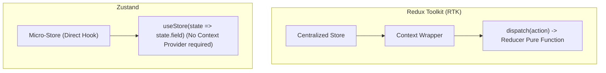

<!-- docs/module-05-advanced-react-state/01-zustand-redux-toolkit.md -->
# 5.1 Global State Management: Zustand vs. Redux Toolkit

## Learning Objectives
- Compare boilerplate, performance, and developer experience between **Zustand** and **Redux Toolkit (RTK)**.
- Implement atomic store slices with persistent browser storage middleware using Zustand.
- Prevent unnecessary re-renders using strict selector equality subscriptions.
- Manage cross-slice actions and asynchronous side effects cleanly.

---

## 1. Architectural Comparison: Zustand vs. Redux Toolkit



### Feature Comparison Matrix

| Metric | Zustand | Redux Toolkit |
| :--- | :--- | :--- |
| **Bundle Size** | ~1.1 KB minzipped | ~11 KB minzipped |
| **Boilerplate** | Minimal; single hook definition | Action creators, slice reducers, dispatchers |
| **Context Provider Needed?** | No (direct hook-based subscription) | Yes (`<Provider store={store}>`) |
| **DevTools Support** | Built-in via Redux DevTools middleware | Native Redux DevTools integration |
| **Best Used For** | Fast, modern SPAs, lightweight client state | Highly structured enterprise apps with extensive action tracing |

---

## 2. Production Zustand Store Implementation

Below is a complete, production-grade Zustand store featuring TypeScript type safety, user authentication state, shopping cart actions, and persistent local storage synchronization:

```typescript
// src/store/useAppStore.ts
import { create } from 'zustand';
import { persist, createJSONStorage, devtools } from 'zustand/middleware';

// 1. Slice Interfaces
export interface UserSession {
  userId: string;
  username: string;
  email: string;
  role: 'Admin' | 'Customer';
  accessToken: string;
}

export interface CartItem {
  sku: string;
  title: string;
  price: number;
  quantity: number;
}

interface AuthSlice {
  user: UserSession | null;
  isAuthenticated: boolean;
  login: (session: UserSession) => void;
  logout: () => void;
}

interface CartSlice {
  items: CartItem[];
  addItem: (item: Omit<CartItem, 'quantity'>) => void;
  removeItem: (sku: string) => void;
  updateQuantity: (sku: string, quantity: number) => void;
  clearCart: () => void;
}

// Combined Store Type
export type AppState = AuthSlice & CartSlice;

// 2. Combined Store with DevTools & LocalStorage Persistence
export const useAppStore = create<AppState>()(
  devtools(
    persist(
      (set) => ({
        // Auth State
        user: null,
        isAuthenticated: false,
        login: (session: UserSession) =>
          set(
            { user: session, isAuthenticated: true },
            false,
            'auth/login'
          ),
        logout: () =>
          set(
            { user: null, isAuthenticated: false, items: [] },
            false,
            'auth/logout'
          ),

        // Cart State
        items: [],
        addItem: (newItem) =>
          set(
            (state) => {
              const existingIndex = state.items.findIndex((i) => i.sku === newItem.sku);
              if (existingIndex > -1) {
                const updatedItems = [...state.items];
                updatedItems[existingIndex] = {
                  ...updatedItems[existingIndex],
                  quantity: updatedItems[existingIndex].quantity + 1,
                };
                return { items: updatedItems };
              }
              return { items: [...state.items, { ...newItem, quantity: 1 }] };
            },
            false,
            'cart/addItem'
          ),
        removeItem: (sku) =>
          set(
            (state) => ({ items: state.items.filter((i) => i.sku !== sku) }),
            false,
            'cart/removeItem'
          ),
        updateQuantity: (sku, quantity) =>
          set(
            (state) => ({
              items:
                quantity <= 0
                  ? state.items.filter((i) => i.sku !== sku)
                  : state.items.map((i) => (i.sku === sku ? { ...i, quantity } : i)),
            }),
            false,
            'cart/updateQuantity'
          ),
        clearCart: () => set({ items: [] }, false, 'cart/clearCart'),
      }),
      {
        name: 'app-storage-session',
        storage: createJSONStorage(() => localStorage),
        // Only persist authentication and cart items
        partialize: (state) => ({ user: state.user, isAuthenticated: state.isAuthenticated, items: state.items }),
      }
    )
  )
);
```

---

## 3. High-Performance Selective Subscriptions

Subscribing to individual properties prevents entire components from re-rendering when unrelated state properties change:

```tsx
// src/components/NavBarUserIndicator.tsx
import React from 'react';
import { useAppStore } from '../store/useAppStore';

export function NavBarUserIndicator() {
  // Selector: This component ONLY re-renders when `user` or `logout` changes!
  // It does NOT re-render when items are added to the cart!
  const user = useAppStore((state) => state.user);
  const logout = useAppStore((state) => state.logout);

  if (!user) {
    return <span className="text-sm text-slate-500">Not logged in</span>;
  }

  return (
    <div className="flex items-center gap-3">
      <span className="text-sm font-semibold text-slate-700">
        {user.username} ({user.role})
      </span>
      <button
        type="button"
        onClick={logout}
        className="px-2.5 py-1 text-xs font-medium text-rose-600 border border-rose-200 rounded hover:bg-rose-50"
      >
        Sign Out
      </button>
    </div>
  );
}
```

```tsx
// src/components/CartBadge.tsx
import React from 'react';
import { useAppStore } from '../store/useAppStore';

export function CartBadge() {
  // Selector computes total count; only re-renders when count changes
  const itemCount = useAppStore((state) =>
    state.items.reduce((sum, item) => sum + item.quantity, 0)
  );

  return (
    <div className="relative inline-flex items-center p-2 text-slate-700 hover:text-indigo-600">
      🛒
      {itemCount > 0 && (
        <span className="absolute -top-1 -right-1 bg-indigo-600 text-white text-[10px] font-bold rounded-full h-5 w-5 flex items-center justify-center">
          {itemCount}
        </span>
      )}
    </div>
  );
}
```

---

## 4. Key Takeaways
1. **Zustand eliminates provider nesting** and offers direct hook subscriptions outside or inside components.
2. Always write **fine-grained selectors** (`useAppStore(state => state.property)`) rather than destructuring the entire state object to prevent re-rendering loops.
3. Use the `persist` middleware to automatically synchronize client session data with `localStorage` or `sessionStorage`.
