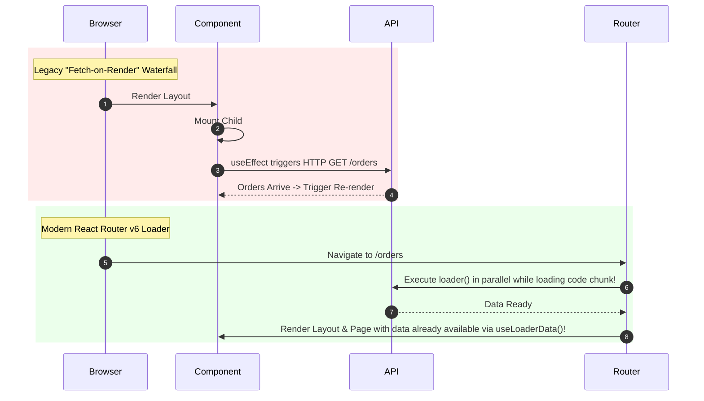

<!-- docs/module-05-advanced-react-state/02-react-router-v6-loaders-actions.md -->
# 5.2 Advanced Routing with React Router v6: Loaders, Actions & Protected Routes

## Learning Objectives
- Architect production applications using the **React Router v6.4+ Data APIs** (`createBrowserRouter`, `RouterProvider`).
- Eliminate "Fetch-on-Render" waterfalls using **Route Loaders** to prefetch data prior to view rendering.
- Enforce Role-Based Access Control (RBAC) and authentication with reusable **Protected Route Guards**.
- Structure nested layouts with `<Outlet />` and global pending navigation state indicators.

---

## 1. Data Fetching Paradigms: Waterfalls vs. Route Loaders



---

## 2. Complete Router Configuration with Loaders & Layouts

```tsx
// src/router/AppRoutes.tsx
import React from 'react';
import {
  createBrowserRouter,
  RouterProvider,
  Navigate,
  Outlet,
  useLoaderData,
  useNavigation,
} from 'react-router-dom';
import { useAppStore } from '../store/useAppStore';

// ---------------- 1. Protected Route Guard ----------------

interface ProtectedRouteProps {
  requiredRole?: 'Admin' | 'Customer';
}

export function ProtectedRoute({ requiredRole }: ProtectedRouteProps) {
  const { isAuthenticated, user } = useAppStore();

  if (!isAuthenticated || !user) {
    return <Navigate to="/login" replace />;
  }

  if (requiredRole && user.role !== requiredRole) {
    return <Navigate to="/unauthorized" replace />;
  }

  return <Outlet />;
}

// ---------------- 2. Root Layout Shell ----------------

export function RootLayout() {
  const navigation = useNavigation();
  const isLoading = navigation.state === 'loading';

  return (
    <div className="min-h-screen bg-slate-50 flex flex-col font-sans">
      {/* Top progress indicator when route loaders are active */}
      {isLoading && (
        <div className="h-1 w-full bg-indigo-200 overflow-hidden fixed top-0 left-0 z-50">
          <div className="h-full bg-indigo-600 animate-pulse w-full" />
        </div>
      )}

      <header className="p-4 bg-white border-b flex justify-between items-center shadow-xs">
        <span className="font-bold text-indigo-600 text-lg">AppPortal</span>
      </header>

      <main className="flex-1 p-6 max-w-5xl mx-auto w-full">
        <Outlet />
      </main>
    </div>
  );
}

// ---------------- 3. Page Components & Loaders ----------------

export interface OrderSummary {
  id: string;
  total: number;
  status: string;
}

// Route Loader: Fetches before rendering component
export async function ordersLoader(): Promise<OrderSummary[]> {
  const token = localStorage.getItem('access_token');
  // Simulated asynchronous API fetch
  await new Promise((resolve) => setTimeout(resolve, 300));

  return [
    { id: 'ORD-101', total: 249.99, status: 'Shipped' },
    { id: 'ORD-102', total: 49.5, status: 'Processing' },
    { id: 'ORD-103', total: 899.0, status: 'Delivered' },
  ];
}

export function OrdersPage() {
  const orders = useLoaderData() as OrderSummary[];

  return (
    <div className="space-y-4">
      <h2 className="text-xl font-bold text-slate-800">Your Orders</h2>
      <div className="divide-y border rounded-lg bg-white overflow-hidden">
        {orders.map((o) => (
          <div key={o.id} className="p-4 flex justify-between items-center">
            <div>
              <p className="font-semibold text-slate-800">{o.id}</p>
              <span className="text-xs text-indigo-600 font-medium">{o.status}</span>
            </div>
            <p className="font-bold text-slate-700">${o.total.toFixed(2)}</p>
          </div>
        ))}
      </div>
    </div>
  );
}

export function LoginPage() {
  const login = useAppStore((state) => state.login);

  const handleSimulatedLogin = () => {
    login({
      userId: 'usr_1',
      username: 'JaneDoe',
      email: 'jane@enterprise.com',
      role: 'Admin',
      accessToken: 'sample_jwt_token',
    });
  };

  return (
    <div className="max-w-sm mx-auto p-6 bg-white rounded-lg shadow-sm border mt-10">
      <h2 className="text-lg font-bold mb-4">Sign In</h2>
      <button
        type="button"
        onClick={handleSimulatedLogin}
        className="w-full py-2 bg-indigo-600 text-white rounded font-medium hover:bg-indigo-700"
      >
        Sign In as Administrator
      </button>
    </div>
  );
}

export function UnauthorizedPage() {
  return (
    <div className="p-8 text-center text-rose-600 font-bold">
      403 Forbidden: You lack permissions for this resource.
    </div>
  );
}

// ---------------- 4. Router Definition ----------------

export const router = createBrowserRouter([
  {
    path: '/',
    element: <RootLayout />,
    children: [
      { path: 'login', element: <LoginPage /> },
      { path: 'unauthorized', element: <UnauthorizedPage /> },
      // Authenticated Routes
      {
        element: <ProtectedRoute />,
        children: [
          {
            path: 'orders',
            element: <OrdersPage />,
            loader: ordersLoader,
          },
        ],
      },
      // Admin Restricted Routes
      {
        element: <ProtectedRoute requiredRole="Admin" />,
        children: [
          {
            path: 'admin/analytics',
            element: <div className="p-4 bg-white rounded">Admin Analytics Dashboard</div>,
          },
        ],
      },
    ],
  },
]);

export function AppRouter() {
  return <RouterProvider router={router} />;
}
```

---

## 3. Key Takeaways
1. **Loaders initiate network operations at the earliest possible instant**—during URL routing rather than after React finishes mounting the component tree.
2. Route nesting with `<Outlet />` simplifies persistent headers, layout bars, and authentication state enforcement.
3. Access control should be verified in route guards, and confirmed by backend API authorization checks.
