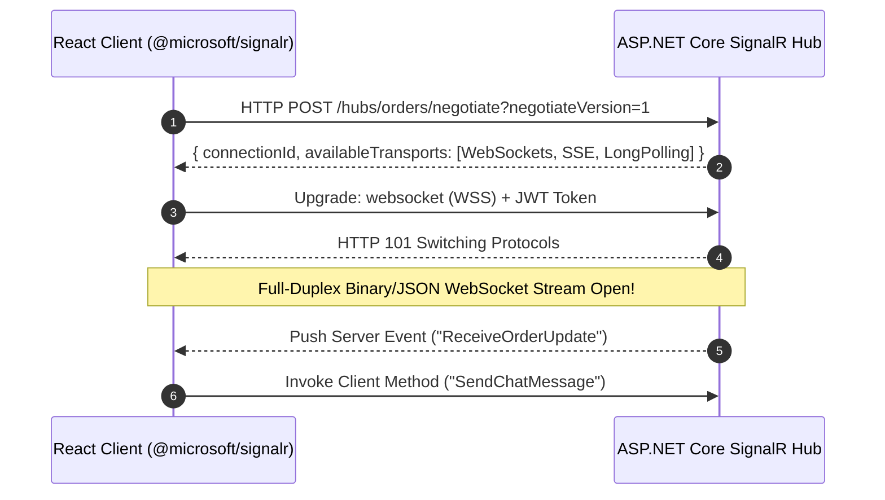

<!-- docs/module-05-advanced-react-state/04-realtime-signalr-react-client.md -->
# 5.4 Real-Time Integration with SignalR in React

## Learning Objectives
- Integrate `@microsoft/signalr` into React 18 applications.
- Configure transport fallbacks (WebSockets -> Server-Sent Events -> Long Polling) and resilient reconnection policies.
- Build a production-grade custom React hook (`useSignalRHub`) to encapsulate connection lifecycle, state subscriptions, and cleanup.
- Handle authentication token injection during WebSocket handshakes.

---

## 1. Connection Architecture & Transport Negotiation



---

## 2. Complete Custom Hook: `useSignalRHub`

Install the official client:
```bash
npm install @microsoft/signalr
```

```typescript
// src/hooks/useSignalRHub.ts
import { useState, useEffect, useRef, useCallback } from 'react';
import * as signalR from '@microsoft/signalr';

export type ConnectionState = 'Disconnected' | 'Connecting' | 'Connected' | 'Reconnecting';

export interface SignalRHookOptions {
  hubUrl: string;
  getAccessToken?: () => string | null;
  autoConnect?: boolean;
}

export function useSignalRHub({ hubUrl, getAccessToken, autoConnect = true }: SignalRHookOptions) {
  const [connectionState, setConnectionState] = useState<ConnectionState>('Disconnected');
  const [lastError, setLastError] = useState<Error | null>(null);
  const connectionRef = useRef<signalR.HubConnection | null>(null);

  useEffect(() => {
    // 1. Build SignalR Connection with resilient retry policies
    const builder = new signalR.HubConnectionBuilder()
      .withUrl(hubUrl, {
        transport: signalR.HttpTransportType.WebSockets | signalR.HttpTransportType.ServerSentEvents,
        accessTokenFactory: () => {
          return getAccessToken ? getAccessToken() ?? '' : '';
        },
      })
      .withAutomaticReconnect({
        // Exponential backoff retry delays in milliseconds: 0s, 2s, 5s, 10s, 30s
        nextRetryDelayInMilliseconds: (retryContext) => {
          const delays = [0, 2000, 5000, 10000, 30000];
          return retryContext.previousAttempts < delays.length
            ? delays[retryContext.previousAttempts]
            : null; // Terminate retries after 5 attempts
        },
      })
      .configureLogging(signalR.LogLevel.Information);

    const connection = builder.Build();
    connectionRef.current = connection;

    // 2. Lifecycle Event Handlers
    connection.onreconnecting((error) => {
      setConnectionState('Reconnecting');
      setLastError(error ?? null);
    });

    connection.onreconnected(() => {
      setConnectionState('Connected');
      setLastError(null);
    });

    connection.onclose((error) => {
      setConnectionState('Disconnected');
      setLastError(error ?? null);
    });

    // 3. Connect
    if (autoConnect) {
      setConnectionState('Connecting');
      connection
        .start()
        .then(() => setConnectionState('Connected'))
        .catch((err) => {
          setConnectionState('Disconnected');
          setLastError(err);
        });
    }

    // 4. Teardown on unmount
    return () => {
      connection.stop().catch(() => {});
      connectionRef.current = null;
    };
  }, [hubUrl, getAccessToken, autoConnect]);

  // Method to register event listeners safely
  const registerHandler = useCallback((eventName: string, handler: (...args: any[]) => void) => {
    const conn = connectionRef.current;
    if (conn) {
      conn.on(eventName, handler);
    }

    return () => {
      connectionRef.current?.off(eventName, handler);
    };
  }, []);

  // Method to invoke server methods
  const invokeMethod = useCallback(async <TResult>(methodName: string, ...args: any[]): Promise<TResult> => {
    if (!connectionRef.current || connectionRef.current.state !== signalR.HubConnectionState.Connected) {
      throw new Error(`Cannot invoke '${methodName}' because SignalR is not in a Connected state.`);
    }
    return connectionRef.current.invoke<TResult>(methodName, ...args);
  }, []);

  return {
    connectionState,
    lastError,
    registerHandler,
    invokeMethod,
  };
}
```

---

## 3. Real-Time Live Feed Component

```tsx
// src/components/LiveOrderFeed.tsx
import React, { useState, useEffect } from 'react';
import { useSignalRHub } from '../hooks/useSignalRHub';

export interface OrderUpdate {
  orderId: string;
  customer: string;
  amount: number;
  status: string;
  timestamp: string;
}

export function LiveOrderFeed() {
  const [orders, setOrders] = useState<OrderUpdate[]>([]);

  const { connectionState, lastError, registerHandler } = useSignalRHub({
    hubUrl: 'http://localhost:5000/hubs/orders',
    getAccessToken: () => localStorage.getItem('access_token'),
  });

  useEffect(() => {
    // Subscribe to server-pushed events
    const unsubscribeNewOrder = registerHandler('OnOrderCreated', (newOrder: OrderUpdate) => {
      setOrders((prev) => [newOrder, ...prev.slice(0, 19)]); // Keep 20 recent
    });

    const unsubscribeStatus = registerHandler(
      'OnOrderStatusChanged',
      (orderId: string, newStatus: string, timestamp: string) => {
        setOrders((prev) =>
          prev.map((o) => (o.orderId === orderId ? { ...o, status: newStatus, timestamp } : o))
        );
      }
    );

    return () => {
      unsubscribeNewOrder();
      unsubscribeStatus();
    };
  }, [registerHandler]);

  const stateColors: Record<string, string> = {
    Connected: 'bg-emerald-500',
    Connecting: 'bg-amber-500',
    Reconnecting: 'bg-rose-500',
    Disconnected: 'bg-slate-400',
  };

  return (
    <div className="p-6 bg-white rounded-xl shadow-md border border-slate-200">
      <div className="flex justify-between items-center mb-4 pb-3 border-b">
        <h2 className="text-xl font-bold text-slate-800">Live Order Stream</h2>
        <div className="flex items-center gap-2">
          <span className={`w-2.5 h-2.5 rounded-full ${stateColors[connectionState] || 'bg-slate-400'} animate-pulse`} />
          <span className="text-xs font-semibold uppercase text-slate-600">{connectionState}</span>
        </div>
      </div>

      {lastError && (
        <div className="mb-4 p-2.5 bg-rose-50 border border-rose-200 text-rose-700 text-xs rounded">
          Connection Issue: {lastError.message}
        </div>
      )}

      {orders.length === 0 ? (
        <div className="p-8 text-center text-sm text-slate-400">
          Listening for live orders from the server...
        </div>
      ) : (
        <div className="space-y-3">
          {orders.map((o) => (
            <div
              key={o.orderId}
              className="p-3 bg-slate-50 border border-slate-200 rounded-lg flex items-center justify-between"
            >
              <div>
                <p className="font-semibold text-slate-800 text-sm">{o.customer}</p>
                <p className="text-xs text-slate-500 font-mono">{o.orderId}</p>
              </div>
              <div className="text-right">
                <p className="font-bold text-indigo-600 text-sm">${o.amount.toFixed(2)}</p>
                <span className="inline-block mt-0.5 px-2 py-0.5 rounded text-[10px] font-bold uppercase bg-indigo-100 text-indigo-700">
                  {o.status}
                </span>
              </div>
            </div>
          ))}
        </div>
      )}
    </div>
  );
}
```

---

## 4. Key Takeaways
1. Clean up event subscriptions inside `useEffect` return statements to avoid duplicate listeners.
2. Leverage `withAutomaticReconnect` with exponential backoff to handle transient network disconnects gracefully.
3. Pass JWT tokens in the `accessTokenFactory` property so SignalR automatically appends authentication to WebSocket handshakes.
