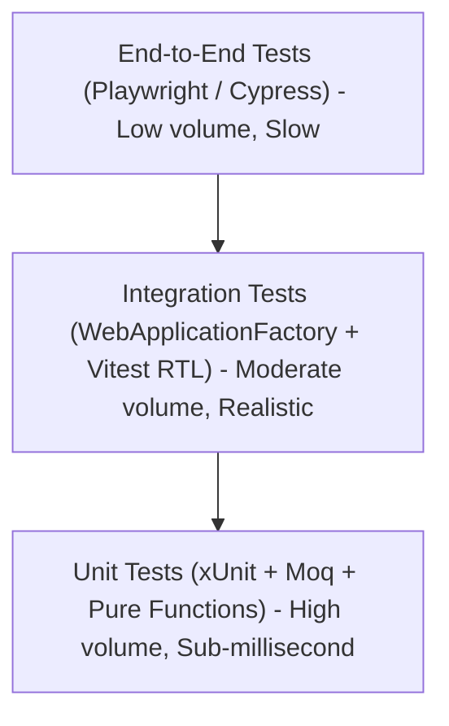

<!-- docs/module-06-e2e-testing-deployment/02-testing-xunit-moq-vitest-rtl.md -->
# 6.2 Automated Testing: xUnit, Moq, Vitest & React Testing Library

## Learning Objectives
- Architect a comprehensive test pyramid: Unit, Integration, and Component tests.
- Test C# business services, FluentValidation rules, and EF Core repositories using **xUnit**, **Moq**, and **FluentAssertions**.
- Execute in-memory HTTP integration tests in ASP.NET Core using `WebApplicationFactory<Program>`.
- Test React components and user workflows using **Vitest**, **React Testing Library (RTL)**, and `@testing-library/user-event`.

---

## 1. The Full-Stack Testing Pyramid



---

## 2. C# Unit Testing with xUnit & Moq

Create an xUnit test project:
```bash
dotnet new xunit -n EnterpriseApp.Tests.Unit
cd EnterpriseApp.Tests.Unit

dotnet add package Moq
dotnet add package FluentAssertions
```

### Complete Service Unit Test

```csharp
namespace EnterpriseApp.Tests.Unit;

using Xunit;
using Moq;
using FluentAssertions;

// Domain & Service Interfaces under test
public sealed record ProcessOrderCommand(Guid OrderId, decimal Amount, string CustomerEmail);
public sealed record ProcessOrderResponse(bool Success, string TransactionId);

public interface IPaymentGateway
{
    Task<string> ChargeAsync(decimal amount, string customerEmail, CancellationToken ct = default);
}

public interface IOrderRepository
{
    Task UpdateOrderStatusAsync(Guid orderId, string status, string transactionId, CancellationToken ct = default);
}

public sealed class OrderFulfillmentService
{
    private readonly IPaymentGateway _gateway;
    private readonly IOrderRepository _repository;

    public OrderFulfillmentService(IPaymentGateway gateway, IOrderRepository repository)
    {
        _gateway = gateway;
        _repository = repository;
    }

    public async Task<ProcessOrderResponse> FulfillOrderAsync(ProcessOrderCommand command, CancellationToken ct = default)
    {
        if (command.Amount <= 0)
        {
            throw new ArgumentOutOfRangeException(nameof(command.Amount), "Order amount must be positive.");
        }

        // 1. Charge Gateway
        string txnId = await _gateway.ChargeAsync(command.Amount, command.CustomerEmail, ct);

        // 2. Persist Status
        await _repository.UpdateOrderStatusAsync(command.OrderId, "Paid", txnId, ct);

        return new ProcessOrderResponse(Success: true, TransactionId: txnId);
    }
}

// ---------------- xUnit Test Suite ----------------

public sealed class OrderFulfillmentServiceTests
{
    private readonly Mock<IPaymentGateway> _mockGateway;
    private readonly Mock<IOrderRepository> _mockRepository;
    private readonly OrderFulfillmentService _sut; // System Under Test

    public OrderFulfillmentServiceTests()
    {
        _mockGateway = new Mock<IPaymentGateway>(MockBehavior.Strict);
        _mockRepository = new Mock<IOrderRepository>(MockBehavior.Strict);
        _sut = new OrderFulfillmentService(_mockGateway.Object, _mockRepository.Object);
    }

    [Fact]
    public async Task FulfillOrderAsync_WithValidOrder_ChargesGatewayAndUpdatesRepository()
    {
        // Arrange
        var command = new ProcessOrderCommand(Guid.NewGuid(), 199.99m, "alice@domain.com");
        string expectedTxnId = "ch_mock_123456";

        _mockGateway
            .Setup(g => g.ChargeAsync(command.Amount, command.CustomerEmail, It.IsAny<CancellationToken>()))
            .ReturnsAsync(expectedTxnId);

        _mockRepository
            .Setup(r => r.UpdateOrderStatusAsync(command.OrderId, "Paid", expectedTxnId, It.IsAny<CancellationToken>()))
            .Returns(Task.CompletedTask);

        // Act
        var result = await _sut.FulfillOrderAsync(command);

        // Assert (FluentAssertions)
        result.Should().NotBeNull();
        result.Success.Should().BeTrue();
        result.TransactionId.Should().Be(expectedTxnId);

        // Verify mocks were invoked with exact parameters
        _mockGateway.Verify(g => g.ChargeAsync(command.Amount, command.CustomerEmail, It.IsAny<CancellationToken>()), Times.Once);
        _mockRepository.Verify(r => r.UpdateOrderStatusAsync(command.OrderId, "Paid", expectedTxnId, It.IsAny<CancellationToken>()), Times.Once);
    }

    [Theory]
    [InlineData(0)]
    [InlineData(-50)]
    public async Task FulfillOrderAsync_WithZeroOrNegativeAmount_ThrowsArgumentOutOfRangeException(decimal invalidAmount)
    {
        // Arrange
        var command = new ProcessOrderCommand(Guid.NewGuid(), invalidAmount, "alice@domain.com");

        // Act & Assert
        var act = async () => await _sut.FulfillOrderAsync(command);
        await act.Should().ThrowAsync<ArgumentOutOfRangeException>()
            .WithParameterName("Amount");

        // Ensure gateway was NEVER called
        _mockGateway.Verify(g => g.ChargeAsync(It.IsAny<decimal>(), It.IsAny<string>(), It.IsAny<CancellationToken>()), Times.Never);
    }
}
```

---

## 3. React Component Testing with Vitest & RTL

Install testing dependencies:
```bash
npm install -D vitest @testing-library/react @testing-library/user-event @testing-library/jest-dom jsdom
```

Configure `vitest.config.ts`:
```typescript
// vitest.config.ts
import { defineConfig } from 'vitest/config';
import react from '@vitejs/plugin-react';

export default defineConfig({
  plugins: [react()],
  test: {
    globals: true,
    environment: 'jsdom',
    setupFiles: './src/test/setup.ts',
  },
});
```

Create test setup file `src/test/setup.ts`:
```typescript
import '@testing-library/jest-dom';
```

### Complete React Component Test

```tsx
// src/components/Counter.test.tsx
import React, { useState } from 'react';
import { render, screen } from '@testing-library/react';
import userEvent from '@testing-library/user-event';
import { describe, it, expect } from 'vitest';

function SimpleCounter({ initialValue = 0, onThresholdReached }: { initialValue?: number; onThresholdReached?: (count: number) => void }) {
  const [count, setCount] = useState(initialValue);

  const increment = () => {
    const next = count + 1;
    setCount(next);
    if (next >= 5 && onThresholdReached) {
      onThresholdReached(next);
    }
  };

  return (
    <div className="p-4">
      <h2 data-testid="counter-value">Count: {count}</h2>
      <button
        type="button"
        onClick={increment}
        className="px-3 py-1 bg-indigo-600 text-white rounded"
      >
        Increment
      </button>
      {count >= 5 && <p className="text-emerald-600 font-bold">Goal Achieved!</p>}
    </div>
  );
}

describe('SimpleCounter Component', () => {
  it('renders with initial default count', () => {
    render(<SimpleCounter initialValue={0} />);
    expect(screen.getByTestId('counter-value')).toHaveTextContent('Count: 0');
    expect(screen.queryByText('Goal Achieved!')).not.toBeInTheDocument();
  });

  it('increments count when button is clicked', async () => {
    const user = userEvent.setup();
    render(<SimpleCounter initialValue={2} />);

    const button = screen.getByRole('button', { name: /increment/i });
    await user.click(button);

    expect(screen.getByTestId('counter-value')).toHaveTextContent('Count: 3');
  });

  it('triggers onThresholdReached callback when count reaches 5', async () => {
    const user = userEvent.setup();
    let thresholdValue = 0;
    const handleThreshold = (val: number) => {
      thresholdValue = val;
    };

    render(<SimpleCounter initialValue={4} onThresholdReached={handleThreshold} />);

    const button = screen.getByRole('button', { name: /increment/i });
    await user.click(button);

    expect(screen.getByTestId('counter-value')).toHaveTextContent('Count: 5');
    expect(screen.getByText('Goal Achieved!')).toBeInTheDocument();
    expect(thresholdValue).toBe(5);
  });
});
```

---

## 4. Key Takeaways
1. Write **unit tests** using `xUnit` and `Moq` for pure domain and service logic to get fast feedback.
2. In React tests, query elements by **user-facing attributes** (accessible role, label, text) rather than internal implementation details.
3. Use `@testing-library/user-event` instead of `fireEvent` to accurately simulate real browser event dispatches.
