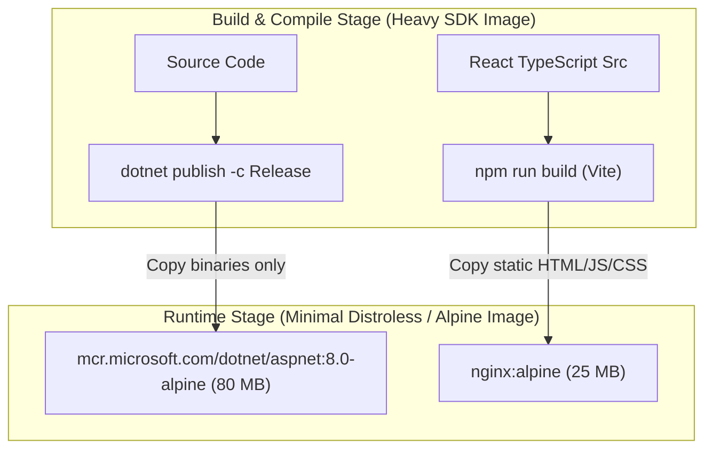

<!-- docs/module-06-e2e-testing-deployment/03-ci-cd-github-actions-docker-deploy.md -->
# 6.3 Containerization with Docker & CI/CD Pipelines via GitHub Actions

## Learning Objectives
- Author high-performance, multi-stage **Dockerfiles** for ASP.NET Core and React Vite.
- Configure production **Nginx** reverse proxy rules to support Single Page Application (SPA) client-side routing (`try_files $uri /index.html`).
- Automate linting, testing, building, and artifact delivery using **GitHub Actions**.
- Implement secrets management, matrix builds, and automated security scans.

---

## 1. Production Multi-Stage Docker Builds

Multi-stage builds decouple the large SDK build environment from the minimal runtime container, reducing image sizes from ~1.2 GB to under 100 MB.



---

## 2. ASP.NET Core Multi-Stage Dockerfile

```dockerfile
# File: server/Dockerfile
# ---------------- Stage 1: Build & Publish ----------------
FROM mcr.microsoft.com/dotnet/sdk:8.0-alpine AS build
WORKDIR /src

# Copy project files first to cache layer dependencies
COPY ["EnterpriseApi.csproj", "./"]
RUN dotnet restore "EnterpriseApi.csproj"

# Copy remaining source code and publish release
COPY . .
RUN dotnet publish "EnterpriseApi.csproj" \
    -c Release \
    -o /app/publish \
    /p:UseAppHost=false

# ---------------- Stage 2: Final Minimal Runtime ----------------
FROM mcr.microsoft.com/dotnet/aspnet:8.0-alpine AS final
WORKDIR /app

# Run as non-root user for security compliance
USER $APP_UID

EXPOSE 8080
ENV ASPNETCORE_URLS=http://+:8080
ENV ASPNETCORE_ENVIRONMENT=Production

COPY --from=build /app/publish .

ENTRYPOINT ["dotnet", "EnterpriseApi.dll"]
```

---

## 3. React SPA Multi-Stage Dockerfile with Nginx

```dockerfile
# File: client/Dockerfile
# ---------------- Stage 1: Build Frontend ----------------
FROM node:20-alpine AS build
WORKDIR /app

# Cache package dependencies
COPY package*.json ./
RUN npm ci

# Copy sources and compile production bundle
COPY . .
RUN npm run build

# ---------------- Stage 2: Production Nginx Server ----------------
FROM nginx:alpine AS final

# Copy custom Nginx configuration supporting SPA routing
COPY nginx.conf /etc/nginx/conf.d/default.conf

# Copy compiled static assets from build stage
COPY --from=build /app/dist /usr/share/nginx/html

EXPOSE 80

CMD ["nginx", "-g", "daemon off;"]
```

### Production Nginx Configuration (`client/nginx.conf`)

```nginx
server {
    listen 80;
    server_name localhost;

    root /usr/share/nginx/html;
    index index.html index.htm;

    # Gzip compression for high network throughput
    gzip on;
    gzip_types text/plain text/css application/json application/javascript text/xml application/xml application/xml+rss text/javascript;

    # Critical: Redirect all route paths to index.html to allow client-side React Router
    location / {
        try_files $uri $uri/ /index.html;
    }

    # Cache static assets aggressively
    location ~* \.(js|css|png|jpg|jpeg|gif|ico|svg|woff|woff2|ttf|eot)$ {
        expires 1y;
        add_header Cache-Control "public, no-transform";
    }

    # Security headers
    add_header X-Frame-Options "SAMEORIGIN";
    add_header X-XSS-Protection "1; mode=block";
    add_header X-Content-Type-Options "nosniff";
}
```

---

## 4. Complete GitHub Actions CI/CD Pipeline

Create `.github/workflows/ci-cd.yml` in your repository root:

```yaml
name: Production CI/CD Pipeline

on:
  push:
    branches: [ "main" ]
  pull_request:
    branches: [ "main" ]

jobs:
  backend-ci:
    name: Build & Test .NET Backend
    runs-on: ubuntu-latest

    steps:
    - name: Checkout Source Code
      uses: actions/checkout@v4

    - name: Setup .NET SDK 8.0
      uses: actions/setup-dotnet@v4
      with:
        dotnet-version: '8.0.x'

    - name: Restore NuGet Packages
      run: dotnet restore EnterpriseSolution.sln

    - name: Build Backend (Release)
      run: dotnet build EnterpriseSolution.sln --no-restore --configuration Release

    - name: Run xUnit Test Suite
      run: dotnet test EnterpriseSolution.sln --no-build --configuration Release --verbosity normal --collect:"XPlat Code Coverage"

  frontend-ci:
    name: Build & Test React Frontend
    runs-on: ubuntu-latest

    steps:
    - name: Checkout Source Code
      uses: actions/checkout@v4

    - name: Setup Node.js 20
      uses: actions/setup-node@v4
      with:
        node-version: 20
        cache: 'npm'
        cache-dependency-path: client/package-lock.json

    - name: Install Frontend Dependencies
      run: npm --prefix client ci

    - name: Run Vitest Suite
      run: npm --prefix client run test -- --run

    - name: Build Vite Production Assets
      run: npm --prefix client run build

  docker-build:
    name: Build & Publish Container Images
    needs: [backend-ci, frontend-ci]
    runs-on: ubuntu-latest
    if: github.ref == 'refs/heads/main' && github.event_name == 'push'

    steps:
    - name: Checkout Code
      uses: actions/checkout@v4

    - name: Set up Docker Buildx
      uses: actions/setup-buildx-action@v3

    - name: Log in to GitHub Container Registry (GHCR)
      uses: docker/login-action@v3
      with:
        registry: ghcr.io
        username: ${{ github.actor }}
        password: ${{ secrets.GITHUB_TOKEN }}

    - name: Build & Push Backend Docker Image
      uses: docker/build-push-action@v5
      with:
        context: ./server
        file: ./server/Dockerfile
        push: true
        tags: |
          ghcr.io/${{ github.repository }}/backend:latest
          ghcr.io/${{ github.repository }}/backend:${{ github.sha }}

    - name: Build & Push Frontend Docker Image
      uses: docker/build-push-action@v5
      with:
        context: ./client
        file: ./client/Dockerfile
        push: true
        tags: |
          ghcr.io/${{ github.repository }}/frontend:latest
          ghcr.io/${{ github.repository }}/frontend:${{ github.sha }}
```

---

## 5. Key Takeaways
1. Multi-stage Docker builds ensure **security compliance and minimal images** by omitting build compilers from runtime environments.
2. The Nginx rule `try_files $uri /index.html;` is required for client-side routing to function without 404 errors on browser refresh.
3. Automated GitHub Actions prevent regressions by enforcing passing unit test suites on every pull request.
