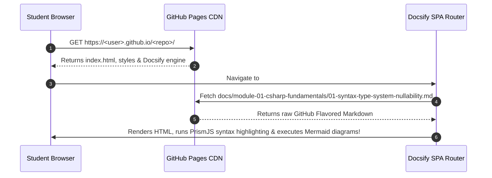

<!-- docs/module-06-e2e-testing-deployment/04-github-pages-publishing-guide.md -->
# 6.4 Publishing Documentation to GitHub Pages

## Learning Objectives
- Deploy this course curriculum directly to **GitHub Pages** with zero compilation steps using Docsify.
- Configure `.nojekyll` to bypass GitHub's default Jekyll engine.
- Automate GitHub Pages deployments using GitHub Actions.
- Configure custom domains, HTTPS certificates, and client-side deep linking.

---

## 1. Zero-Build Documentation Hosting Architecture

Unlike static site generators that require compilation (e.g. Docusaurus, MkDocs, or Hugo), Docsify reads raw Markdown files on the fly in the browser:



---

## 2. Mandatory Configuration Files

Ensure these files are present in your repository root:

1. **`.nojekyll`**: Tells GitHub Pages not to process files through Jekyll. Without this, directories starting with underscores (like `_sidebar.md` or `_navbar.md`) are ignored and return 404.
2. **`index.html`**: The Docsify entrypoint script configuring themes, PrismJS plugins, and Mermaid diagram renderers.
3. **`_sidebar.md`**: Defines the hierarchical table of contents.
4. **`README.md`**: The home page of the course.

---

## 3. Automated GitHub Actions Pages Deployment Workflow

Create `.github/workflows/deploy-docs.yml` to automate publishing whenever changes are merged into `main`:

```yaml
name: Deploy Course Documentation to GitHub Pages

on:
  push:
    branches: [ "main" ]
  workflow_dispatch:

# Set write permissions for GitHub Pages deployment
permissions:
  contents: read
  pages: write
  id-token: write

# Allow one concurrent deployment
concurrency:
  group: "pages"
  cancel-in-progress: true

jobs:
  deploy:
    environment:
      name: github-pages
      url: ${{ steps.deployment.outputs.page_url }}
    runs-on: ubuntu-latest
    steps:
      - name: Checkout Repository
        uses: actions/checkout@v4

      - name: Setup GitHub Pages
        uses: actions/configure-pages@v4

      - name: Upload Documentation Artifact
        uses: actions/upload-pages-artifact@v3
        with:
          # Upload the entire repository root directory containing index.html, _sidebar.md, and docs/
          path: '.'

      - name: Deploy to GitHub Pages
        id: deployment
        uses: actions/deploy-pages@v4
```

---

## 4. Enabling GitHub Pages in Repository Settings

Follow these steps in your GitHub repository:
1. Navigate to **Settings** -> **Pages**.
2. Under **Build and deployment**:
   - **Source**: Select **GitHub Actions**.
3. Push a commit to `main` or trigger the workflow manually from the **Actions** tab.
4. Your course portal will be live at:
   ```text
   https://<your-github-username>.github.io/<repository-name>/
   ```

---

## 5. Key Takeaways
1. `.nojekyll` is **mandatory** for Docsify on GitHub Pages.
2. Using the official `actions/deploy-pages@v4` action provides instant deployments without generating messy orphan `gh-pages` branches.
3. Content edits made in `.md` files reflect live immediately upon push without rebuilding static assets.
